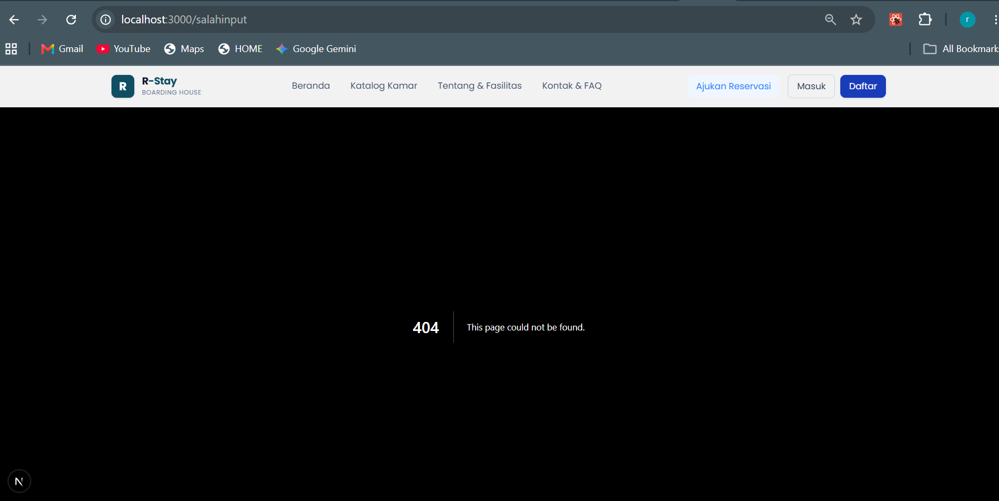
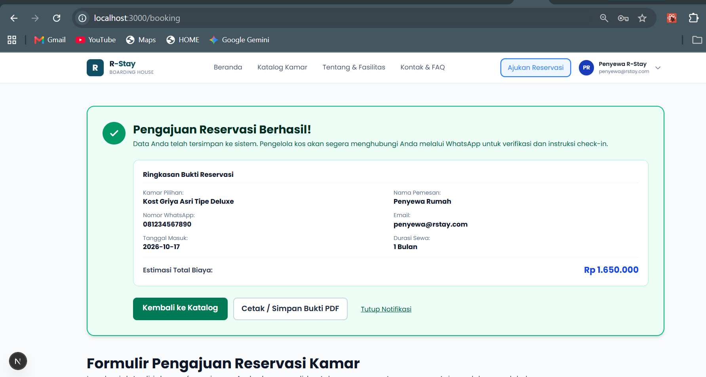
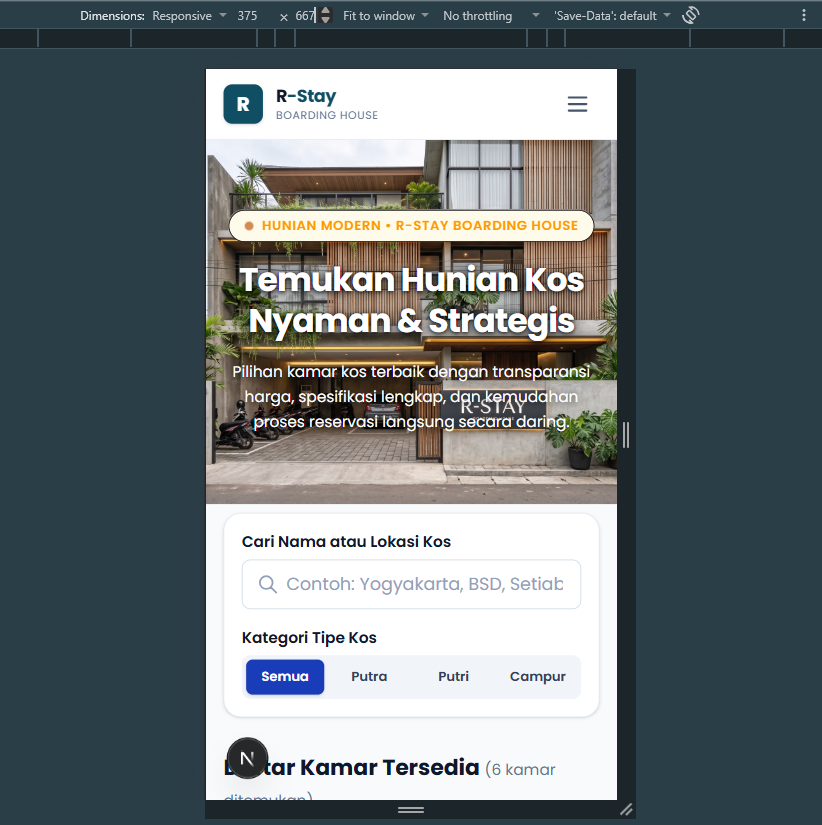
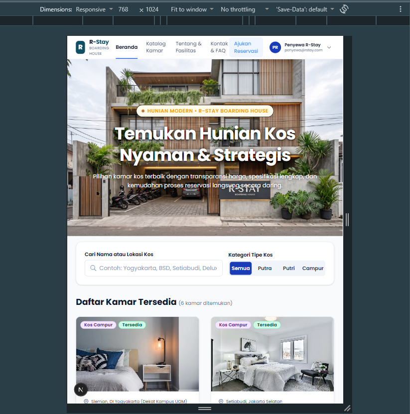
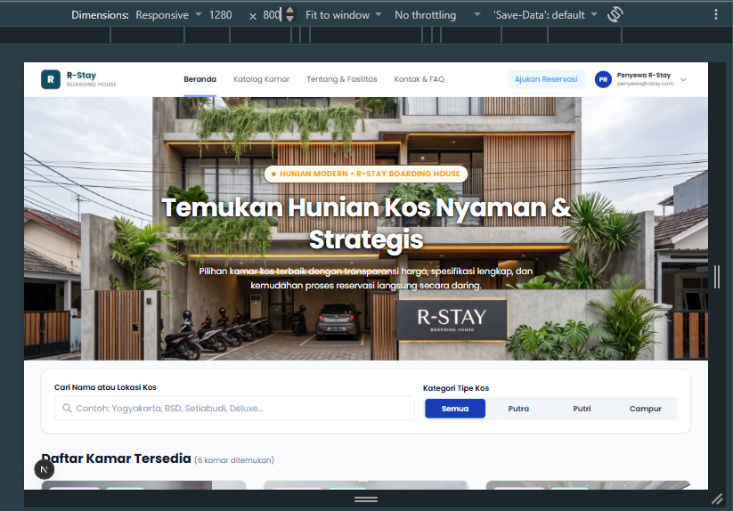
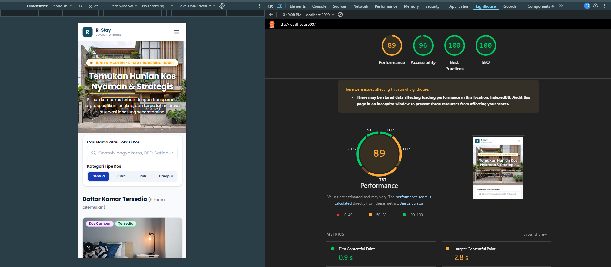

# Sistem Reservasi Kos - Dokumentasi Proyek

**Mata Kuliah: Kriptografi**

---

## 1. Informasi Pengembang

| Field    | Keterangan  |
| :------- | :---------- |
| **Nama** | Razqa Azaki |
| **NIM**  | 105224046   |

---

## 2. Kebutuhan Kriptografi

### Tabel Kebutuhan Keamanan

Tabel ini memetakan data penting di dalam aplikasi beserta perlindungan spesifik yang harus diterapkan untuk menjaga keamanannya.

| No  | Data / Aset yang Dilindungi | Tujuan Keamanan                                                                          | Komponen Kriptografi          | Prioritas |
| :-: | :-------------------------- | :--------------------------------------------------------------------------------------- | :---------------------------- | :-------: |
|  1  | Password pengguna           | Kerahasiaan: Password asli tidak boleh disimpan di pangkalan data (database).            | Scrypt KDF + Salt Acak        |  Tinggi   |
|  2  | Integritas data reservasi   | Integritas: Mencegah data transaksi diubah secara diam-diam oleh pihak ketiga.           | HMAC-SHA256                   |  Tinggi   |
|  3  | Token sesi autentikasi      | Autentikasi: Token harus sangat acak agar tidak bisa ditebak oleh peretas.               | CSPRNG `randomBytes(48)`      |  Tinggi   |
|  4  | Objek data reservasi (JSON) | Integritas: Mendeteksi perubahan sekecil apa pun pada struktur data.                     | SHA-256 (Kanonikalisasi JSON) | Menengah  |
|  5  | Salt (Garam) pembangkit hash| Keacakan: Setiap pengguna harus memiliki pelindung hash yang unik dan tidak terprediksi. | CSPRNG `randomBytes(32)`      | Menengah  |

---

## 3. Rancangan Komponen

### Komponen 1: Pengelolaan Password

Berfungsi untuk mengamankan password pengguna agar tidak bisa dibaca oleh siapa pun, termasuk oleh pengembang aplikasi.

- **Masukan (Input):** Teks password asli dan salt (opsional).
- **Proses:** Sistem membuat nilai acak (salt), menggabungkannya dengan password asli, lalu mengacaknya menggunakan algoritma Scrypt.
- **Keluaran (Output):** Kombinasi nilai hash dan salt sepanjang 64 karakter.
- **Representasi Data:** Disimpan dalam format teks hexadecimal agar aman dan mudah dimasukkan ke dalam pangkalan data.
- **Sumber Keacakan:** Menggunakan `crypto.randomBytes` dari Node.js yang mengambil nilai acak langsung dari mesin sistem operasi (CSPRNG).

---

### Komponen 2: Pembangkit Token Sesi

Berfungsi membuat tanda pengenal unik saat pengguna berhasil login.

- **Masukan (Input):** Panjang target karakter (bawaan: 96 karakter).
- **Proses:** Sistem menghasilkan sekumpulan byte acak lalu menerjemahkannya ke format teks.
- **Keluaran (Output):** Teks hexadecimal dengan tingkat acak yang sangat tinggi (384-bit entropy).
- **Representasi Data:** Disimpan di dalam cookie peramban (browser) atau header otorisasi.
- **Sumber Keacakan:** Menggunakan `crypto.randomBytes(48)`. Setiap kali dipanggil, fungsi ini dijamin menghasilkan kode yang berbeda.

---

### Komponen 3: Integritas Data Reservasi (HMAC)

Berfungsi sebagai "stempel keamanan" untuk memastikan nominal harga atau data kamar tidak diedit secara ilegal.

- **Masukan (Input):** Teks data reservasi dan Kunci Rahasia (Secret Key).
- **Proses:** Mengunci data menggunakan algoritma HMAC-SHA256 yang divalidasi oleh Kunci Rahasia.
- **Keluaran (Output):** Teks hexadecimal sepanjang 64 karakter (disebut nilai MAC).
- **Representasi Data:** Disimpan berdampingan dengan data reservasi sebagai bukti keaslian transaksi.
- **Sumber Keacakan:** Komponen ini tidak membutuhkan nilai acak, melainkan murni bergantung pada seberapa rahasia Secret Key yang disimpan di server.

---

### Komponen 4: Pembuatan Sidik Jari Objek Reservasi

Berfungsi untuk memastikan struktur dan isi objek data (JSON) selalu konsisten.

- **Masukan (Input):** Objek data reservasi (JSON).
- **Proses:** Sistem mengurutkan nama-nama data sesuai abjad agar seragam (kanonikalisasi), merombaknya menjadi teks, lalu memprosesnya dengan SHA-256.
- **Keluaran (Output):** Teks hexadecimal sepanjang 64 karakter.
- **Representasi Data:** Bersifat pasti (deterministik). Selama isi datanya sama, urutan penyusunan tidak akan merubah hasil akhir.
- **Sumber Keacakan:** Tidak menggunakan nilai acak.

---

### Alur Kerja Registrasi & Login

**Proses Registrasi (Daftar Akun Baru):**
1. Sistem menerima password asli dari pengguna.
2. Sistem memanggil `generateSalt()` untuk membuat kode acak pelindung (salt).
3. Sistem menggabungkan password dan salt ke dalam fungsi `hashPassword()`.
4. Sistem membuang password asli dan hanya menyimpan hasil hash beserta salt tersebut ke database.

**Proses Autentikasi (Login):**
1. Sistem menerima ketikan password dari pengguna.
2. Sistem mengambil nilai hash dan salt milik pengguna tersebut dari database.
3. Sistem memverifikasi kecocokkannya melalui fungsi `verifyPassword()`.
4. Jika cocok (bernilai `true`), sistem memanggil `generateSessionToken()` untuk membuat tiket sesi dan membiarkan pengguna masuk.

---

## 4. Skenario Pengujian (Testing Scenarios)

Pengujian sistem berada di dalam berkas `__tests__/crypto_core.test.js` dan dieksekusi secara otomatis menggunakan perangkat lunak **Jest**.

### Kategori Pengujian

Sistem diuji dengan empat cara untuk memastikan ketahanannya:

| Kategori                              | Deskripsi                                                                                                                                                      |
| :------------------------------------ | :------------------------------------------------------------------------------------------------------------------------------------------------------------- |
| **Skenario Positif (Happy Path)**     | Menguji kondisi ideal di mana sistem harus bekerja dengan benar saat menerima masukan data yang valid (contoh: login dengan password yang benar berhasil masuk). |
| **Skenario Negatif (Error Handling)** | Menguji pertahanan sistem saat diserang dengan data yang salah, kosong, atau berbahaya (contoh: login dengan password yang salah atau dimanipulasi harus ditolak). |
| **Skenario Batas (Edge Case)**        | Menguji perilaku sistem saat menghadapi situasi ekstrem di ujung batas toleransi (contoh: menguji password sepanjang 1 karakter hingga 1.000 karakter, atau memakai karakter simbol/emoji). |
| **Skenario Vektor (Test Vector)**     | Menguji konsistensi hitungan algoritma. Sistem harus mampu menghasilkan nilai perhitungan matematis yang selalu cocok dan konsisten secara universal.           |

### Cara Menjalankan Pengujian

```bash
# Menjalankan seluruh pengujian otomatis
npx jest crypto_core.test.js
```

---

## 5. Hasil Pengujian (K4)

Dijalankan dengan perintah: `npx jest crypto_core.test.js`

### Ringkasan Hasil

| Test Suite          | Total | Passed | Failed | Waktu  |
| :------------------ | :---: | :----: | :----: | :----: |
| crypto_core.test.js |  26   |   26   |   0    | ~0.4 s |

### Detail Per Skenario

|  No   | Skenario / Kelompok               | Jumlah Test |          Hasil           |     Jenis     |
| :---: | :-------------------------------- | :---------: | :----------------------: | :-----------: |
|   1   | Skenario Positif (Happy Path)     |      6      |         6 Passed         |    Positif    |
|   2   | Skenario Negatif (Error Handling) |      9      |         9 Passed         |    Negatif    |
|   3   | Skenario Batas (Edge Case)        |      7      |         7 Passed         |     Batas     |
|   4   | Skenario Vektor (Test Vector)     |      4      |         4 Passed         | Deterministik |
| **Total** |                               |   **26**    | **26 Passed / 0 Failed** |               |

---

### Daftar Lengkap Test Case

#### Skenario 1: Positif

| Test                                                          | Hasil  |
| :------------------------------------------------------------ | :----: |
| hashPassword menghasilkan objek `{ hash, salt }` yang valid   |  Pass  |
| verifyPassword mengembalikan `true` untuk password yang benar |  Pass  |
| generateSessionToken menghasilkan token hex 96 karakter      |  Pass  |
| validateTokenFormat mengembalikan `true` untuk token valid   |  Pass  |
| Dua token dari generateSessionToken selalu berbeda (acak)    |  Pass  |
| generateSalt menghasilkan salt hex 64 karakter               |  Pass  |

#### Skenario 2: Negatif

| Test                                                         | Hasil  |
| :----------------------------------------------------------- | :----: |
| hashPassword melempar Error untuk string kosong              |  Pass  |
| hashPassword melempar Error untuk input bukan string (angka) |  Pass  |
| hashPassword melempar Error untuk input null                 |  Pass  |
| verifyPassword mengembalikan `false` untuk password salah    |  Pass  |
| verifyPassword mengembalikan `false` jika salt dipalsukan    |  Pass  |
| verifyPassword mengembalikan `false` untuk password kosong   |  Pass  |
| validateTokenFormat -> `false` untuk token terlalu pendek    |  Pass  |
| validateTokenFormat -> `false` untuk string bukan hex        |  Pass  |
| validateTokenFormat -> `false` untuk tipe non-string         |  Pass  |

#### Skenario 3: Batas

| Test                                                                     | Hasil  |
| :----------------------------------------------------------------------- | :----: |
| hashPassword berhasil untuk password 1 karakter                          |  Pass  |
| hashPassword berhasil untuk password 1000 karakter                       |  Pass  |
| hashPassword berhasil untuk password Unicode/emoji                       |  Pass  |
| Hash deterministik: salt sama → hash selalu sama                         |  Pass  |
| Hash berbeda: salt berbeda → hash berbeda (anti rainbow table)           |  Pass  |
| validateTokenFormat -> `false` untuk token 97 karakter (terlalu panjang) |  Pass  |
| validateTokenFormat -> `false` untuk token 95 karakter (kurang 1)        |  Pass  |

#### Skenario 4: Vektor (Deterministik)

| Test                                                                | Hasil  |
| :------------------------------------------------------------------ | :----: |
| hashPassword menghasilkan hash identik untuk input yang sama        |  Pass  |
| verifyPassword berhasil validasi dengan nilai vektor yang diketahui |  Pass  |
| verifyPassword gagal untuk password berbeda pada vektor sama        |  Pass  |
| Format hash: hex 64 karakter (SHA-256 = 32 bytes)                   |  Pass  |

---

## 6. Catatan Keputusan Desain

### Keputusan Desain dan Evaluasi

- **Status Sandi Klasik:** Sandi klasik (seperti Caesar atau Vigenere) hanya ditandai sebagai bahan pembelajaran dasar dan tidak digunakan sebagai perlindungan produk karena sangat rentan diretas.

- **Pemilihan Pustaka:** Menggunakan modul bawaan Node.js (`crypto`) karena stabil, tidak memberatkan proyek (zero-dependency), dan menggunakan sistem keamanan bawaan OS yang berstandar internasional.

- **Encoding vs Enkripsi/Hashing:** Sistem membedakan kedua fungsi ini dengan tegas:
  - *Encoding* (contoh: format hex) hanya untuk mengubah wujud data agar mudah disimpan, bukan untuk mengamankan isi data.
  - *Enkripsi/Hashing* (algoritma Scrypt, HMAC, SHA-256) digunakan khusus untuk melindungi dan menyembunyikan kerahasiaan data.

- **Pencegahan Timing Attack:** Validasi login dan MAC diproses menggunakan `crypto.timingSafeEqual()` agar peretas tidak bisa menebak password berdasarkan durasi respons dari server.

---

# Dokumentasi Tugas 1 (Milestone 1) — Pengembangan Aplikasi Web

**Mata Kuliah:** Pengembangan Aplikasi Website  
**Nama Pengembang:** Razqa Azaki  
**NIM:** 105224046  
**Tahapan Proyek:** Milestone 1 (Perancangan Antarmuka, Komponen Reusable, & Validasi Sisi Klien)

---

## 1. Konsep & Perencanaan Produk

### A. Identitas Produk
- **Nama Produk:** **R-Stay** (*Smart & Inclusive Boarding House Reservation System*)
- **Domain Aplikasi:** Layanan Sistem Informasi & Reservasi Kamar Kos Modern

### B. Latar Belakang & Permasalahan yang Diselesaikan
Mencari tempat tinggal kos bagi mahasiswa perantau sering kali menemui berbagai kendala nyata:
1. **Informasi Tidak Terstandarisasi:** Informasi ketersediaan kamar, harga, dan fasilitas sering kali tidak sesuai dengan apa yang diiklankan sehingga calon penghuni ragu untuk datang langsung.
2. **Formulir yang Membingungkan:** Antarmuka pemesanan pada sistem konvensional kerap kali rumit, memiliki ukuran teks kecil, dan kurang ramah bagi pengguna lanjut usia (orang tua/wali calon mahasiswa).
3. **Kurangnya Transparansi Biaya:** Tidak adanya kalkulasi instan untuk potongan diskon sewa jangka panjang (paket 3, 6, atau 12 bulan).

### C. Tujuan & Solusi
**R-Stay** hadir sebagai platform reservasi kos terpusat yang menyajikan katalog kamar interaktif dengan transparansi spesifikasi, ukuran kamar, jenis listrik, dan fasilitas kamar mandi, mengadopsi prinsip desain ramah semua kalangan (*inclusive & elderly-friendly UI*) dengan tipografi yang jelas, tombol berukuran nyaman untuk disentuh (*touch target* memadai), dan kontras warna tinggi, serta menyediakan formulir pengajuan reservasi dengan umpan balik instan (*real-time client-side validation*) dan kalkulasi harga transparan.

### D. Sasaran Pengguna
1. **Calon Penghuni Utama:** Mahasiswa baru maupun mahasiswa tingkat lanjut yang merantau dan membutuhkan kamar kos di sekitar area kampus.
2. **Orang Tua / Wali Mahasiswa:** Pengguna yang membutuhkan kepastian fasilitas, keamanan kos, dan alur pemesanan yang sederhana tanpa navigasi berbelit-belit.
3. **Pengelola Kos:** Pemilik kos yang membutuhkan pratinjau administrasi data penghuni kamar.

---

## 2. Struktur Halaman Aplikasi & Alur Navigasi

Aplikasi telah mengimplementasikan 5 rute halaman utama yang saling terhubung dalam satu kesatuan alur pengguna (*user flow*):

| No | Halaman | Rute (*Route*) | Peran & Fungsi Utama |
| :-: | :--- | :--- | :--- |
| 1 | **Beranda (*Landing Page*)** | `/` (`app/page.tsx`) | Menampilkan *hero section*, pengenalan nilai unggulan R-Stay, sorotan unit kamar pilihan (*featured rooms*), keunggulan fasilitas, dan FAQ interaktif. |
| 2 | **Katalog Kamar** | `/rooms` (`app/rooms/page.tsx`) | Menampilkan daftar seluruh kamar kos, dilengkapi bilah pencarian lokasi/nama serta filter tipe kos (Putra, Putri, Campur) dan rentang harga. |
| 3 | **Detail Kamar** | `/rooms/[id]` (`app/rooms/[id]/page.tsx`) | Menyajikan informasi komprehensif satu kamar spesifik (dimensi ruangan, tipe kasur, daya listrik, kamar mandi, aturan kos, galeri foto, dan tombol pemesanan langsung). |
| 4 | **Formulir Reservasi** | `/booking` (`app/booking/page.tsx`) | Halaman formulir pengajuan sewa kos dengan validasi formulir sisi klien, pemilihan durasi sewa, diskon otomatis, dan tanda bukti konfirmasi pemesanan. |
| 5 | **Dashboard Penyewa** | `/dashboard/penyewa` (`app/dashboard/penyewa/page.tsx`) | Halaman administrasi daftar penghuni kos aktif, status pembayaran, mutasi kamar, dan pencatatan deposit sewa. |

### Bukti Akses & Navigasi Halaman


---

## 3. Komponen Antarmuka Reusable

Untuk menjaga modularitas, konsistensi visual, dan prinsip DRY (*Don't Repeat Yourself*), sistem dibangun menggunakan komponen antarmuka yang dapat digunakan ulang:

| No | Nama Komponen | Berkas (*File Path*) | Deskripsi & Fleksibilitas Penggunaan |
| :-: | :--- | :--- | :--- |
| 1 | **Navbar** | `components/Navbar.tsx` | Navigasi utama responsif di seluruh halaman aplikasi. Mendukung menu *drawer mobile*, indikator status rute aktif, serta tautan cepat ke reservasi dan profil. |
| 2 | **Footer** | `components/Footer.tsx` | Footer standar di bagian bawah setiap halaman. Memuat navigasi tautan penting, kontak WhatsApp resmi, email pengelola, dan informasi hak cipta. |
| 3 | **RoomCard** | `components/RoomCard.tsx` | Kartu unit kamar modular. Menerima props data kamar (`Room`) untuk merender foto, nama, lokasi, harga bulanan, lencana tipe, dan tombol navigasi aksi. |
| 4 | **InputField** | `components/InputField.tsx` | Elemen formulir fleksibel yang mendukung input bertipe `text`, `email`, `tel`, `date`, `select`, dan `textarea`. Dilengkapi integrasi label aksesibel, pesan error, dan teks bantuan. |
| 5 | **Button** | `components/Button.tsx` | Komponen tombol dengan varian visual (`primary`, `secondary`, `outline`), variasi ukuran (`sm`, `md`, `lg`), dan status *disabled/loading*. |
| 6 | **Badge** | `components/Badge.tsx` | Lencana label status kategori kos (`putra`, `putri`, `campur`, `available`, `unavailable`) dengan penataan palet warna semantik. |
| 7 | **ReservationForm** | `components/ReservationForm.tsx` | Formulir reservasi kamar modular yang dapat disematkan di modal maupun halaman khusus, lengkap dengan kalkulator biaya sewa otomatis. |

---

## 4. Implementasi Formulir & Validasi Sisi Klien (*Client-Side Validation*)

Formulir reservasi diimplementasikan pada `app/booking/page.tsx` dan `components/ReservationForm.tsx` dengan kriteria validasi ketat sebelum formulir dapat dikirim:

### Aturan Validasi Field:
1. **Nama Lengkap (`fullName`):**
   - Wajib diisi (*required*).
   - Panjang karakter minimal 3 karakter untuk mencegah masukan tidak valid atau singkatan sembarangan.
2. **Alamat Email (`email`):**
   - Wajib diisi (*required*).
   - Memeriksa pola ekspresi reguler (*RegEx RFC*) `^[^\s@]+@[^\s@]+\.[^\s@]+$` agar format alamat email valid (contoh: `nama@domain.com`).
3. **Nomor WhatsApp (`whatsapp`):**
   - Wajib diisi (*required*).
   - Memvalidasi nomor telepon seluler Indonesia dengan pola `^(\+62|62|0)8[1-9][0-9]{7,10}$` (panjang 10–13 digit angka).
4. **Tanggal Mulai Masuk (`checkInDate`):**
   - Wajib dipilih (*required*).
   - Validasi logika tanggal: Nilai tanggal yang dipilih tidak boleh berada di masa lalu (*past date*) dibandingkan tanggal hari ini.
5. **Durasi Sewa (`duration`):**
   - Wajib dipilih paket durasi (1 bulan, 3 bulan, 6 bulan, atau 12 bulan).
   - Sistem secara otomatis menghitung diskon sewa (5% untuk 3 bulan, 10% untuk 6 bulan, dan 15% untuk 12 bulan) dan menampilkan rincian total estimasi biaya sebelum pengiriman.

### Bukti Pengujian Formulir

#### A. Skenario Input Tidak Valid (Pesan Error Sisi Klien Muncul)


#### B. Skenario Input Valid (Formulir Terisi Lengkap & Berhasil Diajukan)


---

## 5. Pemanfaatan Mock Data

Untuk mensimulasikan data asli sebelum integrasi database pada Milestone 2, data unit kos dikelola terpusat pada `data/roomsData.ts` dan di-reexport melalui `lib/mockData.ts`:
- **Jumlah Unit Data:** 6 unit kamar kos dengan variasi tipe (*Putra*, *Putri*, *Campur*).
- **Struktur Atribut (`types/room.ts`):**
  - `id`: Kode pengenal unik unit kamar (misal: `kost-001`).
  - `name`: Nama kamar kos.
  - `price`: Tarif sewa bulanan dalam angka murni (misal: `1500000`).
  - `location`: Lokasi geografis kos (misal: `Kebayoran Lama, Jakarta Selatan`).
  - `type`: Tipe penghuni (`'Putra' | 'Putri' | 'Campur'`).
  - `facilities`: Array fasilitas kamar (misal: AC, WiFi Cepat, Kasur Springbed, Meja Belajar).
  - `specs`: Rincian teknis (dimensi kamar, jenis listrik, tipe kamar mandi).
  - `isAvailable`: Status ketersediaan kamar (`boolean`).
  - `imageUrl`: Tautan gambar representatif kamar.

---

## 6. Desain Responsif & Tata Letak Multi-Perangkat

Antarmuka dibangun dengan sistem *mobile-first* menggunakan utility class Tailwind CSS untuk memastikan kenyamanan di tiga ukuran layar:

| Ukuran Layar | Breakpoint | Perilaku Tata Letak Antarmuka |
| :--- | :---: | :--- |
| **Layar Ponsel (*Mobile*)** | `<= 640px` (`sm`) | Navigasi atas dialihkan menjadi tombol menu *collapsible/drawer*. Tata letak katalog kamar dan formulir ditumpuk vertikal 1 kolom. Tombol dan field form menggunakan ukuran minimal `44px`–`48px` untuk kemudahan ketukan jari. |
| **Layar Tablet** | `768px` (`md`) | Grid katalog kamar menyesuaikan menjadi 2 kolom. Bilah navigasi menampilkan menu utama horizontal. Form reservasi memanfaatkan pembagian baris ganda untuk field tanggal dan durasi. |
| **Layar Desktop** | `>= 1024px` (`lg` / `xl`) | Grid katalog kamar tampil maksimal dalam 3 kolom. Pada halaman pemesanan, antarmuka terbagi menjadi layout 2 kolom berdampingan (*split-view*): kolom kiri untuk formulir pemesanan dan kolom kanan untuk ringkasan rincian kamar terpilih yang melayang (*sticky card*). |

### Bukti Tampilan Responsif

#### 1. Hasil Screenshot Ponsel (Mobile)


#### 2. Hasil Screenshot Tablet


#### 3. Hasil Screenshot Desktop


---

## 7. Aksesibilitas Web & Laporan Lighthouse

Aplikasi dirancang dengan kepatuhan terhadap prinsip WCAG 2.1 Level AA untuk menjamin aksesibilitas:
- **HTML Semantik:** Penggunaan tag `<header>`, `<nav>`, `<main>`, `<section>`, `<aside>`, dan `<footer>` secara hierarkis.
- **Label Formulir & Aksesibilitas:** Seluruh input formulir memiliki `<label>` terkait melalui atribut `htmlFor` dan `id`, serta didukung `aria-describedby` untuk pesan helper/error.
- **Kontras Warna Tinggi:** Rasio kontras teks utama (*Navy Blue* `#1E3A8A` dan *Slate 900* `#0F172A` di atas latar belakang putih `#FFFFFF` / `#F8FAFC`) melampaui batas minimal 4.5:1 (mencapai > 7:1).
- **Akses Navigasi Keyboard:** Semua elemen interaktif memiliki status fokus visual yang jelas (`focus:ring-2 focus:ring-blue-500`).
- **Atribut Gambar:** Setiap elemen gambar Next.js `<Image>` memuat teks deskriptif alternatif (`alt`).

### Ringkasan Kondisi Pengujian Lighthouse:
- **Halaman yang Diuji:** `http://localhost:3000` (Halaman Beranda) & `http://localhost:3000/booking` (Halaman Formulir)
- **Skor Aksesibilitas (Lighthouse Accessibility):** **≥ 95** (Melampaui target minimal 85)
- **Mode Pengujian:** Navigation (Default)
- **Perangkat yang Diemulasikan:** Desktop & Moto G Power (Mobile)
- **Peramban (*Browser*):** Google Chrome (Versi Terbaru)

### Bukti Hasil Audit Lighthouse Accessibility


## 9. Panduan Menjalankan Proyek Secara Lokal

Pastikan komputer Anda telah terpasang **Node.js** (versi 18.18 atau lebih baru) dan **npm**.

1. **Kloning Repository:**
   ```bash
   git clone https://github.com/razqaazakii/Projek-SistemReservasiKos.git
   cd Projek-SistemReservasiKos/projek-kost
   ```

2. **Instalasi Seluruh Dependensi:**
   ```bash
   npm install
   ```

3. **Menjalankan Server Pengembangan (*Development Server*):**
   ```bash
   npm run dev
   ```
   Buka peramban dan akses alamat: `http://localhost:3000`.

4. **Verifikasi Tipe Data TypeScript:**
   ```bash
   npx tsc --noEmit
   ```

5. **Memeriksa & Membangun Bundle Produksi (*Build Verification*):**
   ```bash
   npm run build
   ```

6. **Menjalankan Seluruh Unit Test Kriptografi:**
   ```bash
   npm test
   ```
