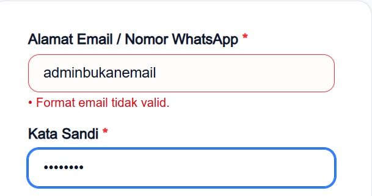
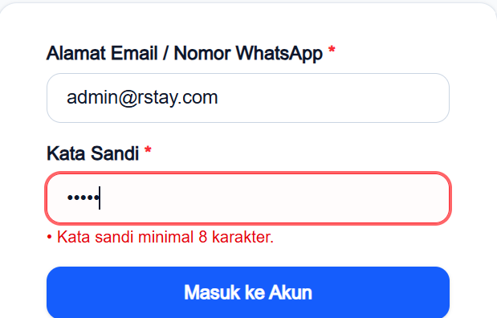
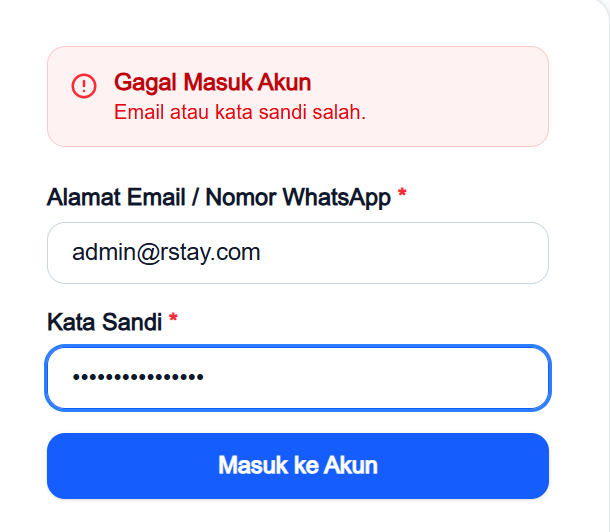
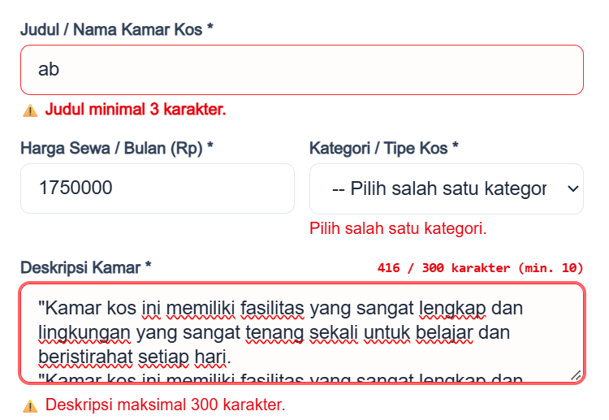
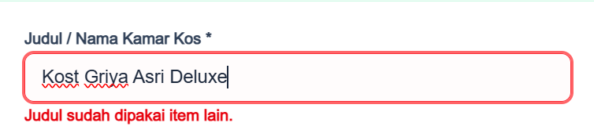
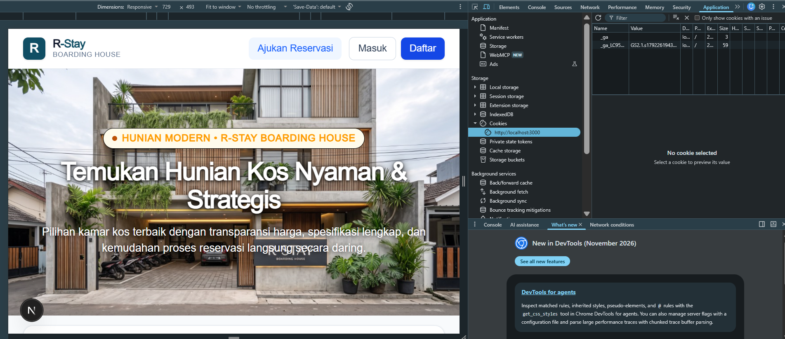
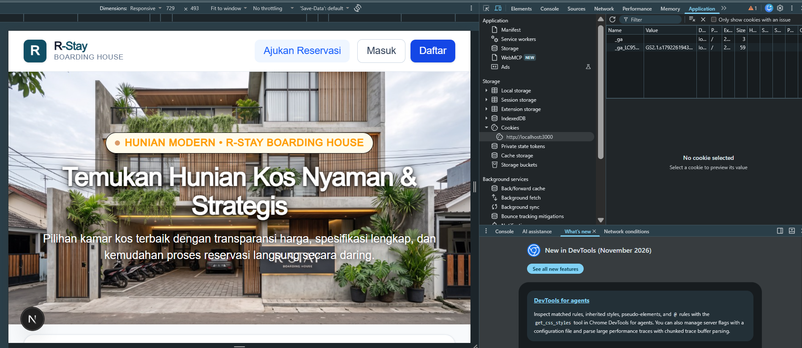
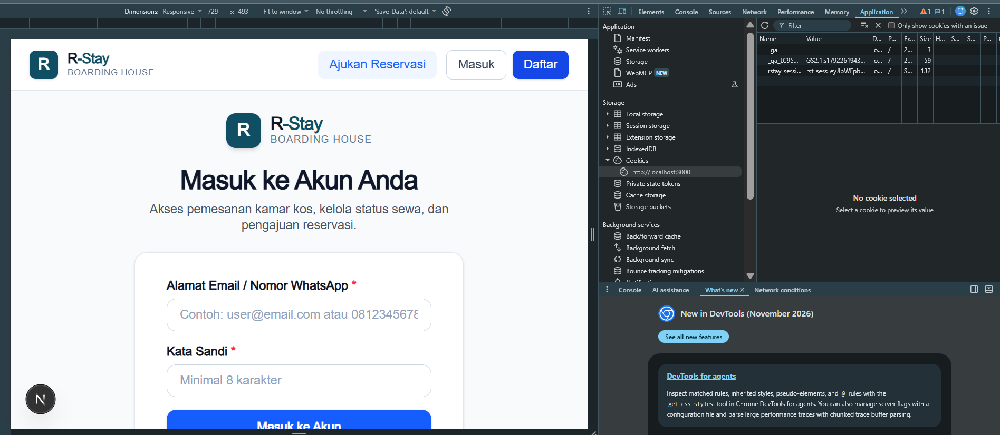

# Dokumen Teknis Modul 5 - Formulir, Validasi, Session, dan Cookie

**Nama** : Razqa Azaki
**NIM**  : 105224046  

## 1. Skema Validasi

### Tabel Kolom Formulir

Berikut adalah pemetaan skema validasi Zod (`lib/validations/room.ts`) yang diterapkan pada formulir penambahan kamar kos (`app/katalog/tambah/page.tsx`):

| Nama Kolom | Tipe Data / Kontrol | Aturan Zod | Pesan Galat (*Error Message*) |
| :--- | :--- | :--- | :--- |
| `name` | `string` (Input Text) | `trim().min(3).max(100)` | `"Judul minimal 3 karakter."` / `"Judul maksimal 100 karakter."` |
| `price` | `number` (Input Number/Text) | `preprocess(numeric).min(100000).max(100000000)` | `"Harga sewa minimal Rp 100.000 per bulan."` / `"Harga sewa tidak valid."` |
| `type` | `enum` (Radio / Select) | `z.enum(['Putra', 'Putri', 'Campur'])` | `"Pilih salah satu kategori."` |
| `location` | `string` (Input Text) | `trim().min(5)` | `"Lokasi kos minimal 5 karakter untuk kejelasan wilayah."` |
| `description` | `string` (Textarea) | `trim().min(10).max(300)` | `"Deskripsi minimal 10 karakter."` / `"Deskripsi maksimal 300 karakter."` |
| `facilities` | `string[]` (Checkbox / Tags) | `array(z.string()).min(1)` atau string transform | `"Minimal cantumkan 1 fasilitas kamar (contoh: AC, WiFi, Kasur)."` |
| `imageUrl` | `string` (Input URL) | `url().optional().or(literal(''))` | `"Format URL gambar tidak valid."` |
| `isAvailable` | `boolean` (Toggle Switch) | `z.boolean().default(true)` | Nilai default `true` |

---

### Aturan Semantik yang Diperiksa di Server Action dan Alasannya

* **Aturan Semantik:**
  Pemeriksaan keunikan Nama/Judul Kamar Kos (`name`). Sistem akan menolak pendaftaran kamar baru apabila nama kamar telah terdaftar di database PostgreSQL.

* **Alasan:**
  Validasi sintaks menggunakan Zod hanya bekerja pada struktur data masukan murni tipe dan panjang karakter tanpa konteks kondisi data yang sudah tersimpan di database. Pemeriksaan semantik memerlukan interaksi tidak bersamaan terhadap database  PostgreSQL untuk mencegah redundansi entitas dan menjaga integritas data katalog.

## 2. Alur Server Action

### Urutan Alur Eksekusi

Setiap permintaan mutasi data pada `tambahItemKatalogAction` (`actions/session.ts`) melewati beberapa tahapan sebagai berikut:

1. **Pemeriksaan Sesi (`bacaSesi()`):** Membaca cookie sesi peramban dan mencocokkan UUID terhadap `serverSessionMap`. Jika sesi tidak valid, langsung mengembalikan status gagal tanpa memproses payload formulir.
2. **Validasi Bentuk (`roomSchema.safeParse()`):** Memastikan seluruh field masukan memenuhi batas minimal, batas maksimal, tipe data, dan format Zod.
3. **Validasi Semantik:** Memeriksa aturan bisnis dinamis terhadap database (pemeriksaan nama unik).
4. **Mutasi Data:** Menjalankan operasi persisten menggunakan Prisma ORM (`prisma.room.create`) ke database PostgreSQL.
5. **Revalidasi Jalur Cache (`revalidatePath`):** Memanggil `revalidatePath('/rooms')`, `revalidatePath('/dashboard/penyewa')`, dan `revalidatePath('/booking')` agar data terbaru langsung ter-render pada permintaan berikutnya.
6. **Respon / Redirect:** Mengembalikan objek status terstruktur `{ success: true, message, data }` kepada komponen klien untuk dieksekusi navigasinya.

### Pembagian Berkas Arsitektur

| Kategori Berkas | Berkas Terkait | Tanggung Jawab Utama |
| :--- | :--- | :--- |
| **Server Component** | `app/masuk/page.tsx`, layout induk | Merender HTML awal di sisi server tanpa menyertakan JavaScript interaktif, membaca header/cookie untuk pemeriksaan awal. |
| **Client Component** | `app/katalog/tambah/page.tsx` (`'use client'`) | Mengelola state formulir lokal, mengendalikan atribut `noValidate`, menangani event input, menampilkan pesan galat per-kolom, dan memicu router klien. |
| **Berkas `"use server"`** | `actions/session.ts`, `actions/room.ts` | Menyediakan fungsi Server Action publik yang aman untuk dipanggil langsung dari klien guna mengeksekusi logika sesi dan manipulasi database. |
| **Modul Pendukung** | `lib/session.ts`, `lib/validations/room.ts`, `proxy.ts` | Penyimpanan sesi in-memory, skema validasi Zod, dan proxy/middleware optimistik rute. |

## 3. Bukti Uji Validasi

Berikut adalah bukti tangkapan layar pengujian validasi formulir beserta penjelasannya:

### 1. Validasi Format Email

* **Penjelasan:** Pengujian dilakukan dengan memasukkan format email yang tidak memenuhi standar penulisan alamat email. Sistem secara otomatis mendeteksi kegagalan dan memunculkan pesan galat *"Format email tidak valid."*.

### 2. Validasi Batas Minimal Panjang Kata Sandi

* **Penjelasan:** Pengujian dilakukan dengan memasukkan kata sandi yang kurang dari 8 karakter. Sistem memicu validasi dan menampilkan pesan galat *"Kata sandi minimal 8 karakter."* untuk memastikan persyaratan keamanan kata sandi pengguna terpenuhi. 

### 3. Validasi Kredensial Akun (Email dan Kata Sandi)

* **Penjelasan:** Pengujian dilakukan dengan memasukkan secara bersamaan email dan kata sandi yang salah / tidak terdaftar di sistem. Sistem menolak proses autentikasi dan menampilkan notifikasi kesalahan umum *"Email atau kata sandi salah."* guna mencegah pengungkapan informasi sensitif akun pengguna.

### 4. Uji Validasi Klien

* **Penjelasan:** Pengujian dilakukan dengan sengaja menonaktifkan validasi bawaan peramban menggunakan atribut `noValidate` pada tag `<form>`. Ketika formulir dikirimkan dengan input yang tidak memenuhi syarat, permintaan langsung diteruskan ke Server Action. Server Action berhasil memvalidasi seluruh data menggunakan Zod dan mengembalikan pesan galat *field-level* ke antarmuka klien, membuktikan bahwa keamanan sistem tidak bergantung pada validasi sisi klien saja.

### 5. Uji Validasi Semantik (Pencegahan Duplikasi Judul Item)

* **Penjelasan:** Pengujian dilakukan dengan menginput judul item kamar kos yang sudah ada sebelumnya di dalam database PostgreSQL (`"Kost Griya Asri Deluxe"`). Validasi bentuk Zod terpenuhi, namun Server Action melakukan pemeriksaan semantik ke database dan menolak operasi dengan pesan *"Judul sudah dipakai item lain."*.

## 4. Session dan Cookie

### Atribut Cookie Sesi dan Alasan Pemilihannya

Konfigurasi cookie sesi pada `lib/session.ts`:

| Atribut Cookie | Nilai Konfigurasi | Alasan Pemilihan & Aspek Keamanan |
| :--- | :--- | :--- |
| **Name** | `sesi` | Nama identifier cookie sesi aplikasi kos. |
| **Value** | UUID v4 (`crypto.randomUUID()`) | Nilai token acak berentropi tinggi, tidak dapat ditebak (*unpredictable*). |
| **Path** | `/` | Memastikan cookie sesi terkirim pada seluruh rute aplikasi (`/katalog`, `/rooms`, `/dashboard`). |
| **HttpOnly** | `false` | **Khusus Skenario Pengujian Praktikum:** Memungkinkan inspeksi dan manipulasi cookie di panel Application browser DevTools untuk pengujian injeksi cookie palsu. *(Pada mode produksi, diwajibkan `true` untuk mencegah pencurian token melalui serangan XSS).* |
| **SameSite** | `lax` | Melindungi aplikasi dari serangan CSRF (*Cross-Site Request Forgery*) pada mutasi lintas domain, sembari tetap menyertakan cookie saat navigasi tautan biasa. |
| **Max-Age** | `86400` (24 Jam) | Membatasi masa aktif sesi pengguna agar sesi kedaluwarsa secara otomatis dalam jangka waktu satu hari. |

### Tangkapan Layar Panel Application dan Header Set-Cookie

#### 1. Panel Application (DevTools)
  
*Keterangan: Nilai cookie sesi ditampilkan di browser DevTools panel Application (nilai token disamarkan demi keamanan).*

#### 2. Header Respons Set-Cookie (Network Tab)
  
*Keterangan: Header respons HTTP `Set-Cookie: sesi=...; Path=/; Max-Age=86400; SameSite=lax` saat proses sesi aktif atau dihapus.*

### Hasil Uji Skenario Sesi

#### 1. Pengujian Cookie Palsu (Injeksi Token Ilegal)

* **Penjelasan:** Pengujian dilakukan dengan memanipulasi nilai cookie `sesi` di DevTools menjadi `sesi-palsu-12345`. Ketika melakukan navigasi rute, `proxy.ts` meloloskan karena hanya mengecek keberadaan kunci. Namun saat formulir disubmit ke Server Action, fungsi `bacaSesi()` memeriksa map sesi server dan menemukan bahwa token tidak terdaftar, sehingga Server Action menolak mutasi dengan pesan *"Silakan masuk terlebih dahulu."*.

#### 2. Pengujian Logout

* **Penjelasan:** Pengujian dilakukan dengan menekan tombol "Keluar / Logout". Server Action `hapusSesiAction()` mengeksekusi penghapusan sesi dari penyimpanan memori server (`serverSessionMap.delete()`) dan menghapus cookie dari peramban (`cookieStore.delete('sesi')`). Pengguna langsung dialihkan ke halaman utama/login.

#### 3. Pengujian Cookie Lama Setelah Logout (*Session Replay Prevention*)

* **Penjelasan:** Pengujian dilakukan dengan menyalin UUID sesi sebelum logout, lalu menyuntikkan kembali nilai UUID lama tersebut ke dalam cookie browser setelah logout dilakukan. Ketika mencoba melakukan submit formulir, Server Action menolak permintaan dengan pesan *"Silakan masuk terlebih dahulu."* karena token tersebut sudah permanen dihapus dari memori server saat proses logout.

## 5. Keputusan Teknis

### Alasan Pola Session di Server dibanding Token di Cookie

1. **Pencabutan Akses Seketika (*Instant Revocation*):**  
   Pada token tanpa status di sisi klien (stateless JWT di cookie), token akan tetap berlaku hingga masa kedaluwarsanya habis kecuali dibuat sistem *blacklist* terpisah. Pola *Server-side Session* (UUID acak di cookie + *store* di server) memberikan kendali mutlak kepada server untuk membatalkan akses secara instan saat logout atau ketika ada indikasi pembobolan akun.
2. **Prinsip Minimasi Data (*Data Minimization*):**  
   Cookie peramban hanya menyimpan pengidentifikasi opaque acak tanpa membawa informasi pribadi (seperti email, role, atau id pengguna), sehingga kebocoran cookie tidak langsung membocorkan identitas pengguna.

---

### Batas Peran `proxy.ts` dibanding Pemeriksaan di Server Action

* **Peran `proxy.ts` (Next.js Middleware/Proxy Boundary):**
  * Beroperasi di level terluar (*edge network layer*) sebelum request mencapai komponen server atau Server Action.
  * Bersifat **optimistik dan cepat (*fast-fail*)**: hanya memeriksa apakah kunci cookie `sesi` eksis. Jika tidak ada sama sekali, pengguna langsung dialihkan ke rute `/masuk`.
  * **Tidak** melakukan kueri basis data atau akses memori yang lambat guna menjaga latensi navigasi tetap instan.
* **Peran Pemeriksaan di Server Action:**
  * Beroperasi sebagai **benteng pertahanan mutlak (*defense in depth*)** di level aplikasi.
  * Melakukan verifikasi kriptografis dan memeriksa apakah UUID yang dibawa cookie benar-benar terdaftar dan aktif di `serverSessionMap`.
  * Menjamin bahwa manipulasi cookie palsu di level proxy tetap akan ditolak sebelum menyentuh logika mutasi data.

## 6. Kendala dan Penyelesaian 

**1. Ketidakcocokan Tipe Data Masukan Numerik pada Skema Zod:**
  * **Kendala yang Dihadapi:** Input harga sewa dari elemen form memicu kegagalan validasi Zod karena ditolak sebagai tipe string padahal skema mengharapkan tipe data angka (*expected number, received string*).
  * **Akar Masalah:** Semua elemen HTML `<input>` secara default selalu mengembalikan nilai bertipe data teks (string) ke event handler JavaScript.
  * **Solusi dan Penyelesaian:** Memanfaatkan fungsi transformasi `z.preprocess()` pada skema Zod untuk membersihkan karakter non-digit dan mengubah tipe string menjadi tipe `number` secara aman sebelum batasan nominal minimum dan maksimum dievaluasi.

## 7. Catatan Pemanfaatan AI

* **Alat:** Antigravity (Gemini 3.8 Flash)
* **Perintah Utama:**
  1. Merancang arsitektur keamanan *defense-in-depth* pemisahan boundary `proxy.ts` dan validasi mutlak `actions/session.ts`.
  2. Mengatasi reset penyimpanan memori sesi akibat Hot Module Replacement menggunakan `globalThis`.
  3. Menyusun alur validasi Server Action berlapis sanitasi Zod, pencegahan bypass `noValidate`, dan validasi semantik Prisma.
* **Bagian yang Digunakan:** `lib/session.ts`, `actions/session.ts`, `proxy.ts`, `lib/validations/room.ts`. 
* **Cara Memverifikasi:**
  1. Uji injeksi cookie palsu di DevTools (Server Action berhasil menolak).
  2. Uji *replay attack* dengan token lama pasca logout (berhasil ditolak).
  3. Uji *bypass* formulir `noValidate` dan cek statis `npx tsc --noEmit`.