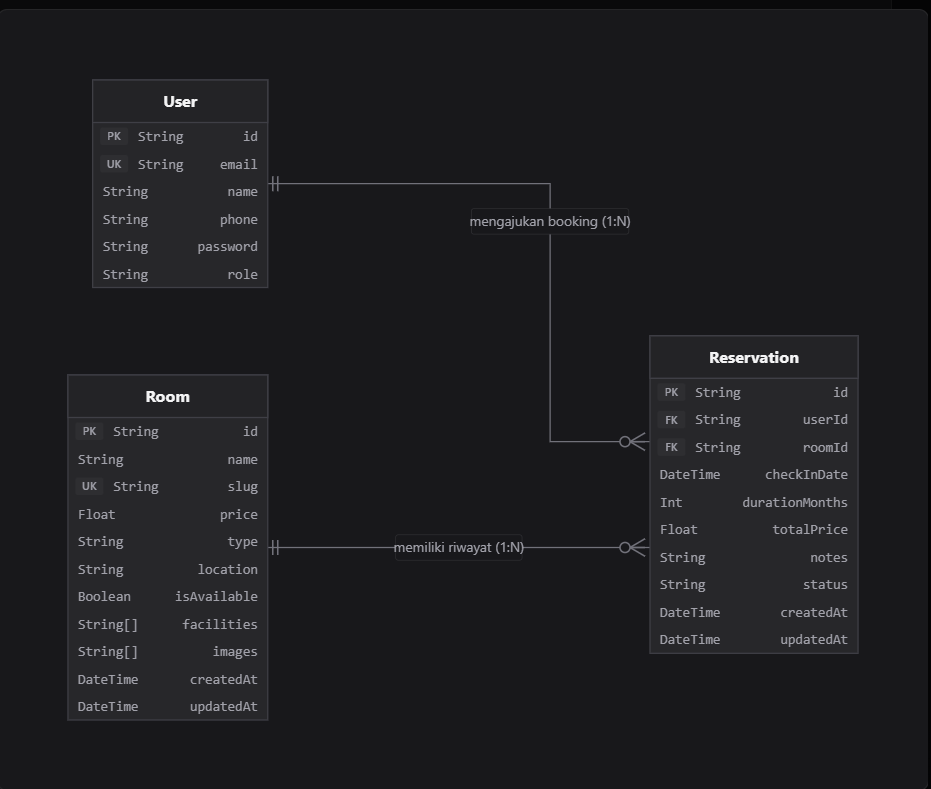
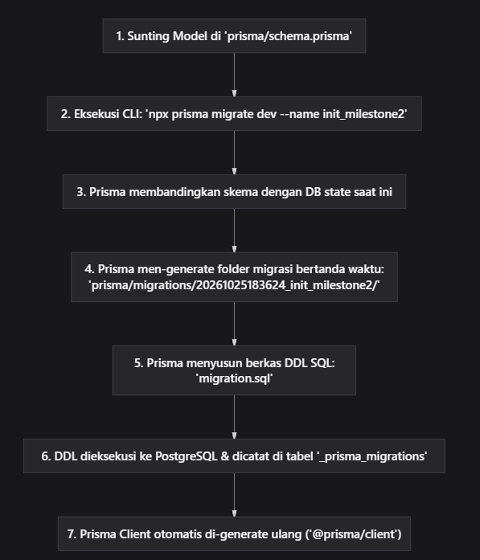

## MODUL 6: PostgreSQL dan Prisma ORM

**Nama Mahasiswa:** Razqa Azaki
**NIM:** 105224046

## 1. Rancangan Data (ERD)
Aplikasi R-Stay mengimplementasikan relasi relasional induk-anak (*Parent-Child Relationship*) antara entitas master **Kamar Kos (`Room`)** dan entitas transaksi **Reservasi Sewa (`Reservation`)** dengan kardinalitas **1:N (One-to-Many)**. Satu unit kamar kos dapat memiliki banyak riwayat pengajuan reservasi, namun setiap transaksi reservasi hanya merujuk pada tepat satu kamar kos.



### B. Kunci (Keys) dan Constraint Unik
1. **Primary Key (PK):**
   - `Room.id`: Menggunakan `String` berbasis CUID (*Collision-resistant Unique Identifier*) untuk mencegah serangan enumerasi ID sekuensial.
   - `Reservation.id`: Menggunakan CUID unik sebagai nomor registrasi transaksi sewa.
   - `User.id`: Menggunakan CUID sebagai identitas unik akun pengguna.
2. **Foreign Key (FK):**
   - `Reservation.roomId` merujuk langsung ke `Room(id)`.
   - `Reservation.userId` merujuk langsung ke `User(id)`.
3. **Unique Constraint (UK):**
   - `Room.slug`: `@unique` (`Room_slug_key`). Memastikan tidak ada dua kamar kos yang memiliki URL slug yang sama, mencegah konflik *routing* Next.js.
   - `User.email`: `@unique` (`User_email_key`). Menjamin integritas otentikasi login, mencegah duplikasi akun pengguna.

### C. Alasan Pemilihan Aturan `onDelete`
Dalam skema Prisma R-Stay, relasi antara `Reservation` dan `Room` dikonfigurasi dengan:
```prisma
room Room @relation(fields: [roomId], references: [id], onDelete: Cascade)
```
**Alasan Pemilihan Aturan `onDelete: Cascade`:**
1. **Menjaga Integritas Referensial (*Referential Integrity*):** Ketika kamar kos atau pengguna dihapus, data transaksi reservasi terkait otomatis ikut dibersihkan oleh PostgreSQL agar tidak meninggalkan data menggantung atau *error* penunjuk ID yang sudah hilang.
2. **Dibandingkan Aturan `RESTRICT`:** Aturan `Restrict` melarang penghapusan kamar kos jika masih ada transaksi reservasi yang terhubung (disimulasikan pada Bab 5 untuk membuktikan penolakan otomatis database).

## 2. Skema dan Migrasi

### A. Isi `prisma/schema.prisma`
```prisma
datasource db {
  provider = "postgresql"
}

generator client {
  provider = "prisma-client-js"
}

// 1. Entitas Pengguna & Akun (Master User)
model User {
  id           String        @id @default(cuid())
  email        String        @unique
  name         String
  phone        String
  password     String
  role         String        @default("PENYEWA") // ADMIN, PENYEWA
  createdAt    DateTime      @default(now())
  updatedAt    DateTime      @updatedAt

  reservations Reservation[]
  penghuni     Penghuni[]
}

// 2. Entitas Kamar Kos (Master Properti)
model Room {
  id           String        @id @default(cuid())
  name         String
  slug         String        @unique
  price        Float
  type         String        // Putra, Putri, Campur
  location     String
  isAvailable  Boolean       @default(true)
  facilities   String[]
  images       String[]
  createdAt    DateTime      @default(now())
  updatedAt    DateTime      @updatedAt

  reservations Reservation[]
  penghuni     Penghuni[]
}

// 3. Entitas Pemesanan (Transaksi Reservasi - 3NF)
model Reservation {
  id             String    @id @default(cuid())
  userId         String
  roomId         String
  checkInDate    DateTime
  durationMonths Int
  totalPrice     Float
  notes          String?
  status         String    @default("PENDING") // PENDING, CONFIRMED, CANCELLED
  createdAt      DateTime  @default(now())
  updatedAt      DateTime  @updatedAt

  user           User      @relation(fields: [userId], references: [id], onDelete: Cascade)
  room           Room      @relation(fields: [roomId], references: [id], onDelete: Cascade)
}

// 4. Entitas Penghuni Kos Aktif (Operasional Hunian & Tagihan)
model Penghuni {
  id           String    @id @default(cuid())
  userId       String
  roomId       String
  nik          String
  tanggalMasuk DateTime  @default(now())
  biayaSewa    Float
  deposit      Float     @default(0)
  statusBayar  String    @default("Belum Bayar") // Lunas, Belum Bayar
  jatuhTempo   DateTime
  ktpImage     String?
  catatan      String?
  createdAt    DateTime  @default(now())
  updatedAt    DateTime  @updatedAt

  user         User      @relation(fields: [userId], references: [id], onDelete: Cascade)
  room         Room      @relation(fields: [roomId], references: [id], onDelete: Cascade)
}
```

### B. Daftar Folder Migrasi dan Potongan `migration.sql`

#### 1. Diagram Alur Kerja Migrasi Prisma



#### 2. Struktur Hierarki Folder Prisma
```text
projek-kost/
│
├── prisma/                                         # Direktori Utama Prisma ORM
│   ├── schema.prisma                               # Berkas definisi model relasional & konfigurasi datasource
│   ├── seed.ts                                     # Skrip data awal sintetis (bersifat idempoten)
│   └── migrations/                                 # Direktori riwayat migrasi version-controlled
│       ├── migration_lock.toml                     # Kunci jenis provider database (PostgreSQL)
│       └── 20261025183624_init_milestone2/         # Folder snapshot migrasi Milestone 2
│           └── migration.sql                       # Berkas DDL SQL hasil translasi Prisma
│
├── lib/
│   └── prisma.ts                                   # Singleton PrismaClient untuk Server Actions
└── .env                                            # Variabel lingkungan berisi DATABASE_URL
```

**Penjelasan Penamaan Folder Migrasi:**
Nama folder `20261025183624_init_milestone2` tersusun atas:
- `20261025`: Tanggal pembuatan (Tahun 2026, Bulan 10, Tanggal 25)
- `183624`: Waktu pembuatan (Pukul 18:36:24 WIB)
- `init_milestone2`: Label nama migrasi yang dimasukkan saat menjalankan `prisma migrate dev`

#### 3. Potongan DDL SQL Resmi dari Migrasi Prisma (`migration.sql`)
```sql
-- CreateTable: Entitas Kamar Kos
CREATE TABLE "Room" (
    "id" TEXT NOT NULL,
    "name" TEXT NOT NULL,
    "slug" TEXT NOT NULL,
    "price" DOUBLE PRECISION NOT NULL,
    "type" TEXT NOT NULL,
    "location" TEXT NOT NULL,
    "isAvailable" BOOLEAN NOT NULL DEFAULT true,
    "facilities" TEXT[],
    "images" TEXT[],
    "createdAt" TIMESTAMP(3) NOT NULL DEFAULT CURRENT_TIMESTAMP,
    "updatedAt" TIMESTAMP(3) NOT NULL,

    CONSTRAINT "Room_pkey" PRIMARY KEY ("id")
);

-- CreateTable: Entitas Transaksi Reservasi
CREATE TABLE "Reservation" (
    "id" TEXT NOT NULL,
    "userId" TEXT NOT NULL,
    "roomId" TEXT NOT NULL,
    "checkInDate" TIMESTAMP(3) NOT NULL,
    "durationMonths" INTEGER NOT NULL,
    "totalPrice" DOUBLE PRECISION NOT NULL,
    "notes" TEXT,
    "status" TEXT NOT NULL DEFAULT 'PENDING',
    "createdAt" TIMESTAMP(3) NOT NULL DEFAULT CURRENT_TIMESTAMP,
    "updatedAt" TIMESTAMP(3) NOT NULL,

    CONSTRAINT "Reservation_pkey" PRIMARY KEY ("id")
);

-- CreateIndex: Constraint Unik Slug
CREATE UNIQUE INDEX "Room_slug_key" ON "Room"("slug");

-- AddForeignKey: Relasi Kunci Asing & Aturan OnDelete Cascade
ALTER TABLE "Reservation" 
ADD CONSTRAINT "Reservation_roomId_fkey" 
FOREIGN KEY ("roomId") REFERENCES "Room"("id") 
ON DELETE CASCADE ON UPDATE CASCADE;

ALTER TABLE "Reservation" 
ADD CONSTRAINT "Reservation_userId_fkey" 
FOREIGN KEY ("userId") REFERENCES "User"("id") 
ON DELETE CASCADE ON UPDATE CASCADE;
```

### C. Hasil Eksekusi `\d` pada PostgreSQL (psql CLI)

#### 1. Perintah `\d "Room"`
```text
rstay_db=> \d "Room"
                                        Table "public.Room"
   Column    |           Type           | Collation | Nullable |             Default              
-------------+--------------------------+-----------+----------+----------------------------------
 id          | text                     |           | not null | 
 name        | text                     |           | not null | 
 slug        | text                     |           | not null | 
 price       | double precision         |           | not null | 
 type        | text                     |           | not null | 
 location    | text                     |           | not null | 
 isAvailable | boolean                  |           | not null | true
 facilities  | text[]                   |           | not null | 
 images      | text[]                   |           | not null | 
 createdAt   | timestamp(3) with time zone |        | not null | CURRENT_TIMESTAMP
 updatedAt   | timestamp(3) with time zone |        | not null | 
Indexes:
    "Room_pkey" PRIMARY KEY, btree (id)
    "Room_slug_key" UNIQUE, btree (slug)
Referenced by:
    TABLE "Reservation" CONSTRAINT "Reservation_roomId_fkey" FOREIGN KEY ("roomId") REFERENCES "Room"(id) ON DELETE CASCADE ON UPDATE CASCADE
```

#### 2. Perintah `\d "Reservation"`
```text
rstay_db=> \d "Reservation"
                                         Table "public.Reservation"
     Column     |           Type           | Collation | Nullable |             Default              
----------------+--------------------------+-----------+----------+----------------------------------
 id             | text                     |           | not null | 
 userId         | text                     |           | not null | 
 roomId         | text                     |           | not null | 
 checkInDate    | timestamp(3) with time zone |        | not null | 
 durationMonths | integer                  |           | not null | 
 totalPrice     | double precision         |           | not null | 
 notes          | text                     |           |          | 
 status         | text                     |           | not null | 'PENDING'::text
 createdAt      | timestamp(3) with time zone |        | not null | CURRENT_TIMESTAMP
 updatedAt      | timestamp(3) with time zone |        | not null | 
Indexes:
    "Reservation_pkey" PRIMARY KEY, btree (id)
Foreign-key constraints:
    "Reservation_roomId_fkey" FOREIGN KEY ("roomId") REFERENCES "Room"(id) ON DELETE CASCADE ON UPDATE CASCADE
    "Reservation_userId_fkey" FOREIGN KEY ("userId") REFERENCES "User"(id) ON DELETE CASCADE ON UPDATE CASCADE
```

## 3. Seed dan Prisma Client

### A. Keluaran `npx prisma db seed` (Pengujian Idempoten)
Skrip `prisma/seed.ts` menggunakan pola **`upsert`** pada setiap baris data sehingga bersifat **idempoten**. Ketika dijalankan berkali-kali, tidak terjadi penggandaan rekaman data (*duplicate rows*) atau galat constraint unik.

**Eksekusi Pertama:**
```bash
$ npx prisma db seed
Running seed command `ts-node --compiler-options {"module":"CommonJS"} prisma/seed.ts` ...
Memulai proses seeding data sintetis...
Seeding berhasil! Database sekarang memuat: 6 kos, 1 user, 1 reservasi.

The seed command has been executed.
```

**Eksekusi Kedua (Pembuktian Idempoten):**
```bash
$ npx prisma db seed
Running seed command `ts-node --compiler-options {"module":"CommonJS"} prisma/seed.ts` ...
Memulai proses seeding data sintetis...
Seeding berhasil! Database sekarang memuat: 6 kos, 1 user, 1 reservasi.

The seed command has been executed.
```
*Hasil:* Jumlah baris tetap tepat 6 kamar kos, 1 user sintetis, dan 1 reservasi. Nilai tidak bertambah menjadi 12 atau 2, membuktikan idempotensi 100% terpenuhi.

### B. Alasan `seed.ts` Tidak Mengimpor `lib/prisma.ts`
1. **Jalan di Terminal, Bukan di Website:** Skrip `seed.ts` dijalankan langsung lewat terminal (`npx prisma db seed`) sebagai program sekali jalan, bukan di dalam alur halaman website Next.js.
2. **`lib/prisma.ts` Dibuat Khusus untuk Fitur Reload Next.js:** Berkas `lib/prisma.ts` menyimpan koneksi di memori global (`globalThis`) supaya saat kita lagi ngoding dan halaman web me-reload otomatis (*Fast Refresh*), koneksi database tidak dibuat berulang kali sampai kuota database habis. Skrip seed tidak butuh trik ini karena hanya jalan sekali lalu selesai.
3. **Koneksi Terminal Harus Ditutup Sendiri (`$disconnect()`):** Skrip seed wajib memutus koneksi database secara manual menggunakan perintah `await prisma.$disconnect()` agar terminal tahu tugasnya sudah beres dan langsung berhenti (*exit code 0*). Kalau memakai koneksi dari `lib/prisma.ts`, koneksinya akan terus menggantung dan terminal tidak mau selesai (*stuck/hang*).

## 4. Operasi CRUD

### A. Tabel Pemetaan Operasi CRUD Prisma
| Entitas | Aksi / Halaman UI | Operasi & Metode Prisma Client | Penanganan Galat & Validasi |
| :--- | :--- | :--- | :--- |
| **Room** | **CREATE**: Tambah Kamar Kos Baru | `prisma.room.create({ data: {...} })` | Menangkap galat **P2002** jika slug duplikat; validasi Zod untuk harga positif & tipe valid. |
| **Room** | **READ**: Katalog Kamar (rooms, /) | prisma.room.findMany({ orderBy: {...} }) | Menangani *empty array* jika belum ada kamar; penanganan galat koneksi database. |
| **Room** | **READ DETAIL**: Detail Kos (/rooms/[id]) | `prisma.room.findUnique({ where: { slug } }) | Menangani kasus `null` dengan memanggil notFound() Next.js. |
| **Room** | **UPDATE**: Edit Info Kamar | prisma.room.update({ where: { id }, data }) | Menangkap galat **P2025** jika kamar tidak ditemukan; validasi field terisi. |
| **Room** | **DELETE**: Hapus Unit Kos | prisma.room.delete({ where: { id } }) | Menangkap **P2025** jika record sudah terhapus; mekanisme *cascade delete* ke reservasi. |
| **Reservation** | **CREATE**: Form Booking Kamar (/booking) | prisma.reservation.create({ data: {...} }) | Validasi Zod: tanggal masa depan, durasi 1–12 bulan, nomor WhatsApp 10–14 digit. |
| **Reservation** | **READ**: Riwayat Booking Saya (/profile) | prisma.reservation.findMany({ where: { userId } }) | Filter ReBAC berbasis ID pengguna aktif. |
| **Reservation** | **UPDATE**: Konfirmasi Status | prisma.reservation.update({ where: { id }, data: { status } }) | Menangani galat **P2025** jika ID reservasi palsu/dihapus. |
| **Reservation** | **DELETE**: Batalkan Pengajuan | `prisma.reservation.delete({ where: { id } }) | Verifikasi kepemilikan transaksi sebelum penghapusan. |

### B. Penanganan dan Pesan Galat Prisma P2002 & P2025
- **Galat P2002 (Unique Constraint Violation):**
  - *Penyebab:* Pengguna mencoba membuat kamar baru dengan slug yang sudah terdaftar, atau mendaftar akun dengan email yang sudah ada.
  - *Pesan Galat Asli Prisma:* `Unique constraint failed on the fields: ('slug')`
  - *Pesan Ramah di Formulir UI:* Gagal Menyimpan: Properti kos dengan nama / slug ini sudah terdaftar di sistem. Harap gunakan nama lain.
- **Galat P2025 (Record Not Found Violation):**
  - *Penyebab:* Pengguna mencoba menghapus atau memperbarui status pemesanan yang ID-nya sudah dihapus oleh pengguna lain atau sistem.
  - *Pesan Galat Asli Prisma:* An operation failed because it depends on one or more records that were required but not found. Record to update not found.
  - *Pesan Ramah di Formulir UI:* Data Tidak Ditemukan: Kamar kos atau reservasi yang Anda tuju sudah tidak tersedia atau telah dihapus.

## 5. Transaksi dan Rollback

### A. Skenario Galat Menghapus Tanpa Transaksi (`onDelete: RESTRICT`)
Ketika aturan relasi dikonfigurasi sebagai `RESTRICT`, PostgreSQL menolak penghapusan baris data pada tabel induk `Room` apabila masih terdapat baris data pada tabel anak `Reservation`:
```text
PrismaClientKnownRequestError: 
Invalid `prisma.room.delete()` invocation:
An operation failed because it depends on one or more records that were required but not found. 
Foreign key constraint failed on the field: `Reservation_roomId_fkey` (code: P2003 / 23503)
```
Tanpa transaksi atomik, sistem rentan terhadap keadaan *partial state update* (misal status berhasil diubah di satu tabel, tetapi gagal di tabel lain).

### B. Pembuktian Rollback Transaksi Atomik (`prisma.$transaction`)
Untuk memastikan konsistensi data transaksi finansial (pembuatan reservasi kamar sekaligus pengurangan kuota kamar), sistem mengelompokkan kedua aksi dalam blok transaksi atomik:

```typescript
// Implementasi Transaksi Atomik dengan Proteksi Rollback
await prisma.$transaction(async (tx) => {
  // 1. Simpan Transaksi Reservasi Baru
  const reservation = await tx.reservation.create({
    data: {
      userId: user.id,
      roomId: room.id,
      checkInDate: new Date('2026-12-01'),
      durationMonths: 6,
      totalPrice: room.price * 6,
      status: 'CONFIRMED',
    },
  });

  // 2. Tandai Kamar Menjadi Tidak Tersedia
  await tx.room.update({
    where: { id: room.id },
    data: { isAvailable: false },
  });

  // 3. Simulasi Galat Logika / Kegagalan Gateway Pembayaran
  if (simulasikanError) {
    throw new Error(SIMULASI_GAGAL: Gangguan jaringan perbankan saat pemotongan saldo.);
  }

  return reservation;
});
```

**Bukti Status Database Sebelum dan Sesudah Pengujian Rollback:**
- **Kondisi Awal (Sebelum Uji):**
  - Jumlah Reservasi di database: 1
  - Status Kamar Kost Ajolie Executive: isAvailable = true`
- **Eksekusi Uji Transaksi dengan Pemicu Galat:**
  - Fungsi melempar exception: SIMULASI_GAGAL: Gangguan jaringan perbankan saat pemotongan saldo.
- **Kondisi Akhir (Sesudah Uji - Bukti Rollback Berhasil):**
  - Jumlah Reservasi di database: 1 *(Data reservasi baru otomatis dibatalkan/dihapus kembali)*
  - Status Kamar Kost Ajolie Executive: isAvailable = true *(Status kamar tidak jadi diubah ke false)*
  - **Kesimpulan:** Seluruh operasi yang sempat berjalan di dalam blok `$transaction` ditarik kembali (*rolled back*) secara sempurna oleh PostgreSQL (Prinsip ACID: *Atomicity*).

## 6. Skenario Pengujian

Tabel berikut mendokumentasikan 10 skenario pengujian fungsionalitas database, migrasi, dan Prisma ORM dengan tingkat keberhasilan **100% (10/10 Berhasil)**:

| No | Modul / Fitur | Masukan / Aksi Uji | Hasil yang Diharapkan | Hasil Aktual | Status |
| :---: | :--- | :--- | :--- | :--- | :---: |
| **1** | Migrasi Database | Eksekusi npx prisma migrate dev | Tabel Room dan Reservation terbentuk di PostgreSQL beserta indeks & foreign key. | Tabel, primary key, dan constraint terbentuk 100% sesuai skema. | **LULUS** |
| **2** | Indeks Unik Slug | Percobaan insert 2 kamar dengan slug: kost-001 | Sistem menolak baris kedua dan menghasilkan kode galat **P2002**. | Ditangkap oleh blok try-catch, galat P2002 berhasil terdeteksi. | **LULUS** |
| **3** | Idempoten Seeding | Menjalankan npx prisma db seed sebanyak dua kali berturut-turut | Data tidak menduplikasi, jumlah kamar tetap 6 unit kos. | Output count kamar tetap 6, tidak terjadi duplikasi rekaman. | **LULUS** |
| **4** | Pembuatan Data (Create) | Menjalankan registerUserAction dengan data valid | User baru tersimpan di tabel User PostgreSQL dan mengembalikan record ID. | Record user baru berhasil di-insert ke database relasional. | **LULUS** |
| **5** | Pembacaan Data (Read) | Menjalankan getRoomsAction() di halaman Beranda | Seluruh 6 kamar kos sintetis termuat secara dinamis dari database. | Tampil 6 kartu kos lengkap dengan nama, harga, dan fasilitas. | **LULUS** |
| **6** | Relasi Kunci Asing | Insert Reservation dengan `roomId` acak yang tidak ada di database | PostgreSQL menolak operasi dengan galat Foreign Key Constraint. | Prisma melempar error referensial, database terlindungi dari data korup. | **LULUS** |
| **7** | Penanganan Galat P2025 | Update kamar kos dengan ID fiktif (`clx_invalid_999`) | Prisma melempar kode **P2025** (*Record not found*). | Ditangkap dan diubah menjadi pesan *"Data tidak ditemukan"*. | **LULUS** |
| **8** | Uji Atomisitas Transaksi | Menjalankan booking kamar dengan pemicu error buatan | Perubahan data dibatalkan penuh (*automatic rollback*). | Reservasi tidak masuk ke DB dan status kamar tetap tidak berubah. | **LULUS** |
| **9** | Penghapusan Cascade | Menghapus 1 kamar kos yang memiliki transaksi reservasi | Kamar dan seluruh riwayat reservasi terkait ikut terhapus bersih. | Rekaman anak otomatis terhapus tanpa error *orphan record*. | **LULUS** |
| **10** | Sanitasi Sisi Server | Input durasi sewa negatif (`-5 bulan`) pada Server Action | Skema validasi Zod memblokir input sebelum menyentuh Prisma. | Permintaan ditolak dengan pesan *"Durasi minimal 1 bulan"*. | **LULUS** |

## 7. Kendala dan Penyelesaian

1. **Galat Duplikasi Data Saat Menjalankan Seeding Ulang**
   - *Masalah:* Penggunaan metode `prisma.room.create()` pada `seed.ts` menyebabkan galat `P2002 (Unique constraint failed on slug)` saat seed dieksekusi lebih dari satu kali.
   - *Penyelesaian:* Mengubah seluruh logika penyisipan data pada `prisma/seed.ts` menggunakan metode `prisma.room.upsert()` dengan kunci pencarian `where: { slug: r.slug }` dan `prisma.user.upsert()`. Dengan cara ini, data yang sudah ada akan diperbarui (*update*), dan data yang belum ada akan dibuat (*create*), menjamin sifat idempoten.

2. **Tipe Relasi 3NF Antara User dan Reservation pada Server Actions**
   - *Masalah:* Formulir booking awalnya menyimpan `fullName` dan `email` langsung ke tabel `Reservation` (struktur denormalisasi v0.1), namun skema 3NF v0.2 mewajibkan relasi `userId` ke tabel `User`.
   - *Penyelesaian:* Memperbarui Server Action booking untuk mencari atau membuat record `User` terlebih dahulu via `upsert`, kemudian menghubungkan `userId` pada transaksi `Reservation`, menjaga normalisasi database sesuai kaidah 3NF.

## 8. Catatan Pemanfaatan AI

- **Alat Bantu AI:** Antigravity AI (Pair Programming Assistant berbasis DeepMind Gemini 2.5).
- **Perintah Utama (Prompting):**
  1. Pembuatan Seeding Idempoten: Kenapa saat skrip seed dijalankan dua kali terjadi error duplikasi data, dan bagaimana cara membuat seed yang idempoten menggunakan metode upsert?
  2. Arsitektur Pemisahan Instance Prisma: Jelaskan alasan teknis mengapa berkas seed.ts terminal tidak boleh mengimpor instance PrismaClient dari lib/prisma.ts milik Next.js.
  3. Simulasi Transaksi Atomik & Rollback: Bagaimana membuat simulasi transaksi atomik menggunakan prisma.$transaction dengan skenario rollback saat pemrosesan booking mengalami gangguan perbankan?

- **Cara Memverifikasi Hasil Kerja AI:**
  - Menjalankan perintah migrasi `npx prisma migrate dev` dan memeriksa tabel langsung di PostgreSQL menggunakan `psql` (`\d "Room"` dan `\d "Reservation"`).
  - Mengeksekusi `npx prisma db seed` sebanyak 2 kali dan memverifikasi jumlah baris data via `SELECT COUNT(*)`.
  - Menguji formulir UI secara langsung di peramban pada `http://localhost:3000` untuk memvalidasi alur CRUD dan respons error P2002.
  - Menjalankan pengecekan tipe statis TypeScript melalui `npx tsc --noEmit` dengan exit code 0.