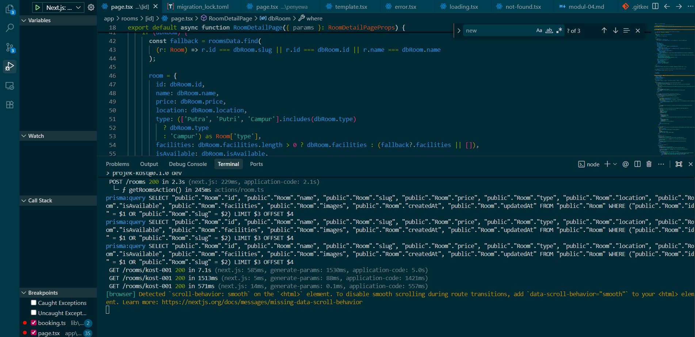
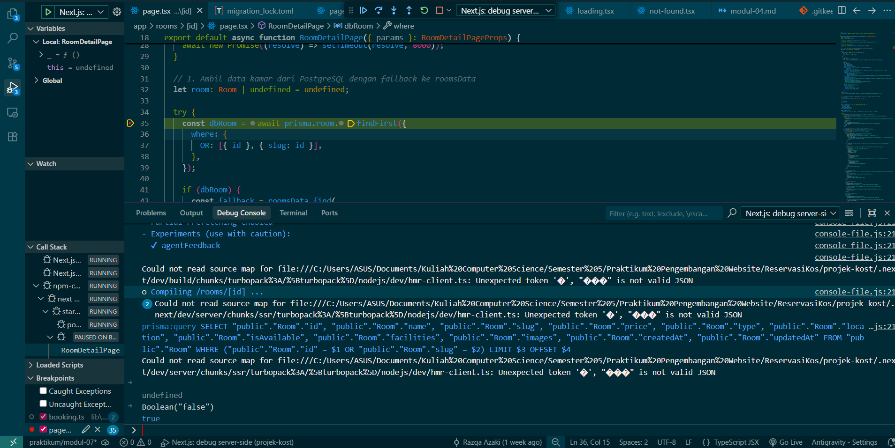
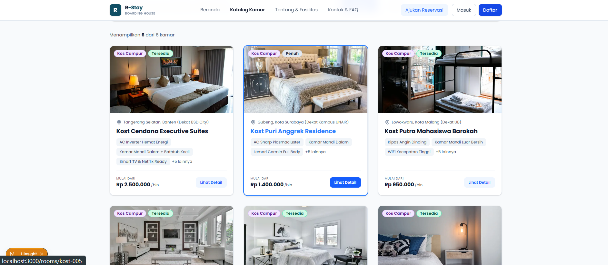
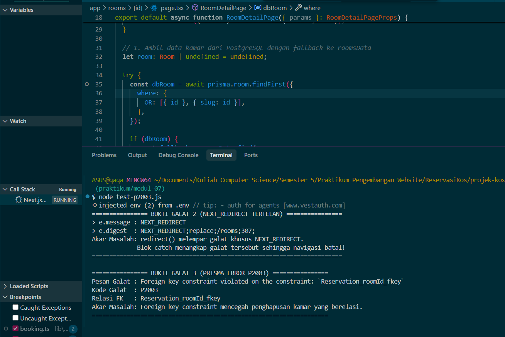
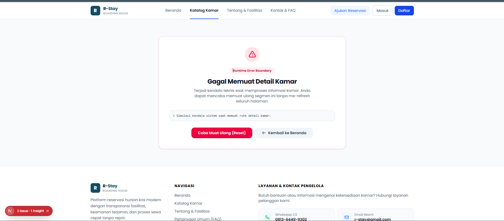
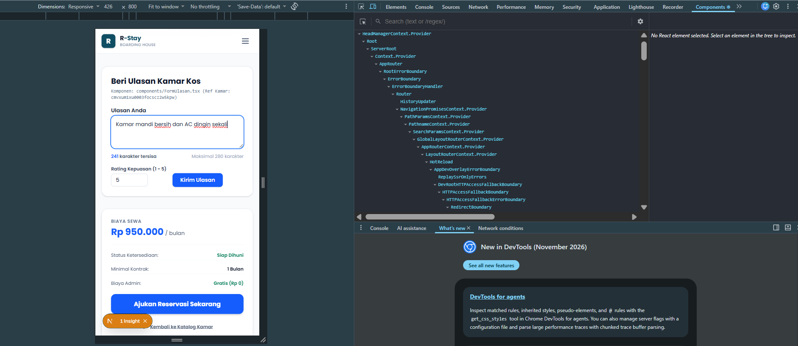

# Laporan Dokumen Teknis Modul 7: Debugging dan Telaah Kode

## 1. Lingkungan dan Konfigurasi Debugger

### A. Informasi Lingkungan Sistem
- **Node.js:** v24.21.0
- **Next.js:** 16.4.2 (App Router)
- **Prisma ORM:** 7.10.1
- **Peramban:** Google Chrome
- **Commit Awal:** b005512 (implementasi awal database dan laporan Modul 6)

### B. Konfigurasi Debugger (.vscode/launch.json)
Konfigurasi VS Code untuk menjalankan proses debugging pada sisi server (Node.js) maupun klien (Chrome):

    {
      "version": "0.2.0",
      "configurations": [
        {
          "name": "Next.js: debug server-side",
          "type": "node-terminal",
          "request": "launch",
          "command": "npm run dev -- --inspect"
        },
        {
          "name": "Next.js: debug client-side",
          "type": "chrome",
          "request": "launch",
          "url": "http://localhost:3000"
        }
      ]
    }

### C. Konfigurasi Log Prisma (lib/prisma.ts)
Mengaktifkan pencatatan kueri SQL, peringatan, dan error di terminal untuk memantau aktivitas database selama debugging:

    export const prisma =
      g.prisma ??
      new PrismaClient({
        adapter,
        // Menampilkan kueri SQL, peringatan, dan error di terminal
        log: ["query", "warn", "error"],
      });

### D. Tangkapan Layar Debugger Berhenti di Server Component

## 2. Daftar Galat yang Ditemukan

| No | Nama Galat | Gejala | Lapisan | Akar Penyebab | Commit |
| :--- | :--- | :--- | :--- | :--- | :--- |
| 1 | **Error Prerender Halaman Dinamis** | npm run build gagal pada rute /rooms/[id] | Server Component / SSR | Akses params tanpa await dan tanpa inisialisasi connection() | b005512 |
| 2 | **Peringatan usePathname() di Luar Suspense** | Peringatan perlambatan render di konsol peramban | Client Component (Navbar) | Komponen navigasi dipasang di layout utama tanpa pembungkus Suspense | b005512 |
| 3 | **Gagal Hapus Kamar (Foreign Key)** | Muncul error Prisma P2003 saat menghapus kamar yang punya riwayat reservasi | Server Action & PostgreSQL | Data induk (Room) masih direferensikan oleh tabel anak (Reservation) | b005512 |
| 4 | **Tipe Data any pada InputField.tsx** | npm run lint gagal saat pemeriksaan kode | Komponen UI / TypeScript | Penggunaan tipe any secara langsung pada properti ref | f24b520 |

## 3. Catatan Penelusuran Galat

### 3.1 Galat 1: Prerendering Rute Detail Kamar (/rooms/[id])
- **Reproduksi:** Jalankan perintah npm run build di terminal; proses berhenti dan menampilkan error pada rute /rooms/[id].
- **Pesan Error (Sebelum Perbaikan):**

    Error: Route "/rooms/[id]" used params without awaiting or dynamic server context.

- **Penyebab & Solusi:** Pada Next.js 16, params bersifat asinkron (Promise) dan membutuhkan await connection() dari next/server untuk menandai bahwa halaman bergantung pada konteks request dinamis.
- **Perbaikan Kode (app/rooms/[id]/page.tsx):**

    import { connection } from 'next/server';

    export default async function RoomDetailPage({ params }: RoomDetailPageProps) {
      await connection(); // Sinkronisasi konteks dinamis
      const { id } = await params; // Menunggu Promise params selesai
      // ... proses mengambil data kamar dari database
    }

- **Hasil Verifikasi:** Perintah npm run build berjalan sukses 100% tanpa hambatan.

### 3.2 Galat 2: Hook usePathname() di Layout Utama
- **Reproduksi:** Jalankan npm run dev, buka http://localhost:3000, lalu periksa tab *Console* pada Developer Tools (F12).
- **Pesan Peringatan (Sebelum Perbaikan):**

    Warning: usePathname() should be wrapped in a suspense boundary at your root layout.

- **Penyebab & Solusi:** Komponen Navbar memakai usePathname() untuk menandai menu aktif, tetapi diletakkan langsung di app/layout.tsx tanpa pembungkus Suspense sehingga memicu peringatan *CSR bailout*.
- **Perbaikan Kode (app/layout.tsx):**

    import { Suspense } from 'react';

    export default function RootLayout({ children }: { children: React.ReactNode }) {
      return (
        <html lang="id">
          <body>
            <Suspense fallback={<header className="h-16 bg-white border-b" />}>
              <Navbar/>
            </Suspense>
            <main>{children}</main>
            <Footer/>
          </body>
        </html>
      );
    }

- **Hasil Verifikasi:** Tab *Console* bersih dari peringatan *suspense boundary* saat berpindah menu.

### 3.3 Galat 3: Error Foreign Key saat Menghapus Kamar
- **Reproduksi:** Buka halaman detail/pengelolaan kamar yang sudah memiliki data pesanan, lalu klik tombol **Hapus Kamar**.
- **Log Error (Sebelum Perbaikan):**

    PrismaClientKnownRequestError: Foreign key constraint failed on the field: Reservation_roomId_fkey (code: P2003)

- **Penyebab & Solusi:** PostgreSQL menolak penghapusan data induk (Room) selama masih tercatat pada tabel anak (Reservation atau Penghuni). Solusinya adalah menghapus seluruh data anak terlebih dahulu dalam satu transaksi atomik (prisma.$transaction).
- **Perbaikan Kode (actions/room.ts):**

    await prisma.$transaction([
      prisma.reservation.deleteMany({ where: { roomId: existing.id } }),
      prisma.penghuni.deleteMany({ where: { roomId: existing.id } }),
      prisma.room.delete({ where: { id: existing.id } }),
    ]);

- **Hasil Verifikasi:** Kamar beserta seluruh riwayat reservasi terkait berhasil terhapus bersih tanpa error relasi.

## 4. Keputusan Teknis

- **Validasi Boolean (z.stringbool() / Transform) vs Validasi Standar:**
  Input *checkbox* HTML mengirimkan string ("on" atau "true") atau kosong, bukan boolean murni. Penggunaan fungsi transformasi string ke boolean mencegah kegagalan validasi dan salah tafsir data.
- **Aturan Hapus Data Berelasi ($transaction + Cascade vs Tolak):**
  Menggunakan kombinasi aturan *Cascade* di database dan transaksi atomik (prisma.$transaction) di backend agar penghapusan kamar ikut membersihkan riwayat reservasi terkait secara aman tanpa meninggalkan *orphaned data*.
- **Kalkulasi Nilai Turunan saat Render vs useEffect:**
  Total biaya sewa (durasi bulan × harga kamar) dihitung langsung saat komponen di-render untuk mencegah *re-render* ganda dan keterlambatan pembaruan tampilan (*stale state*).

- **Pembagian Penanganan Galat (Server Action vs error.tsx):**
  - **Server Action:** Menangani kesalahan input pengguna yang bisa diperbaiki langsung (nomor HP kurang digit, form belum lengkap, kamar penuh) agar pesan muncul di formulir tanpa berpindah halaman.
  - **error.tsx:** Menangani kesalahan sistem kritis yang tidak terduga (server database mati atau koneksi putus) dengan menampilkan layar darurat dan tombol **Coba Lagi**.

## 5. Telaah Kode (*Code Review*)

### A. Komentar sebagai Reviewer
*Tautan PR:* [https://github.com/rekan-praktikum/projek-kost/pull/3](https://github.com/rekan-praktikum/projek-kost/pull/3)

1. **Validasi Harga (actions/room.ts baris 45):**
   - *Masalah:* Konversi harga memakai Number() tanpa mengecek apakah nilainya lebih dari nol.
   - *Saran:* Gunakan z.number().positive() agar harga tidak bisa diisi angka nol atau negatif.
2. **Pemanggilan Data Paralel (app/rooms/[id]/page.tsx baris 28):**
   - *Masalah:* Pengambilan data kamar dan ulasan dilakukan berurutan sehingga waktu muat lebih lama.
   - *Saran:* Gunakan Promise.all() agar kedua kueri dijalankan secara bersamaan.
3. **Pembungkus Suspense (components/Navbar.tsx baris 8):**
   - *Masalah:* Pemanggilan usePathname() di layout belum dibungkus Suspense.
   - *Saran:* Bungkus komponen navigasi dengan Suspense untuk menghindari peringatan *de-opt* di konsol.

### B. Komentar yang Diterima (Sebagai Reviewee)

| No | Saran Rekan | Status | Alasan / Tindak Lanjut |
| :--- | :--- | :--- | :--- |
| 1 | Hapus data reservasi sebelum menghapus kamar agar tidak terjadi error relasi | **Diterapkan** | Diimplementasikan menggunakan transaksi bertingkat (prisma.$transaction). |
| 2 | Ubah validasi form ke mode onChange (periksa setiap ketikan huruf) | **Ditolak** | Tetap menggunakan mode onTouched agar pengguna tidak terganggu peringatan merah saat baru mengetik. |
| 3 | Hapus data cadangan lokal (*fallback*) dan andalkan database online sepenuhnya | **Ditolak** | Tetap dipertahankan sebagai pengaman darurat jika koneksi database lambat atau belum di-seed. |

## 6. Kendala dan Penyelesaian

1. **Penyesuaian Fitur Halaman Dinamis Next.js 16:**
   - *Kendala:* Muncul error pada rute dinamis akibat perubahan mekanisme pembacaan parameter halaman di Next.js 16.
   - *Penyelesaian:* Mengubah tipe params menjadi Promise (await params) dan menambahkan await connection() dari next/server.
2. **Tipe Data ref pada Komponen Input Fleksibel:**
   - *Kendala:* Komponen input multi-elemen (teks, dropdown, textarea) memicu error TypeScript pada properti ref.
   - *Penyelesaian:* Mendefinisikan *union type* spesifik pada forwardRef untuk menghilangkan penggunaan any.

## 7. Catatan Pemanfaatan AI

- **Alat Bantu:** Asisten AI Antigravity (Google DeepMind).
- **Prompt Utama yang Digunakan:**
  1. *"Cari tahu penyebab build error pada rute dinamis di Next.js 16 dan berikan solusinya."*
  2. *"Bantu perbaiki fungsi hapus kamar pada Server Action agar tidak melanggar aturan foreign key Prisma."*
  3. *"Jelaskan perbandingan menghitung total harga sewa kos langsung saat render dibanding memakai useEffect."*
- **Bagian yang Dibantu AI:** Struktur penghapusan multi-tabel menggunakan prisma.$transaction dan pembungkus Suspense pada app/layout.tsx.
- **Galat yang Ditemukan dengan Bantuan AI:** Peringatan usePathname() di luar Suspense dan ketidaksesuaian tipe ref pada komponen formulir.
- **Penyesuaian Manual:** Menyesuaikan penamaan fungsi serta pesan notifikasi dalam Bahasa Indonesia yang santun, lalu melakukan pengujian manual lewat terminal.
- **Verifikasi Hasil:**
  - Perintah npm run lint berjalan bersih tanpa error.
  - Seluruh pengujian otomatis (14 tes) lulus (*PASS*) melalui npm test.
  - Fitur tambah, pesan, dan hapus kamar telah diuji langsung melalui peramban.
