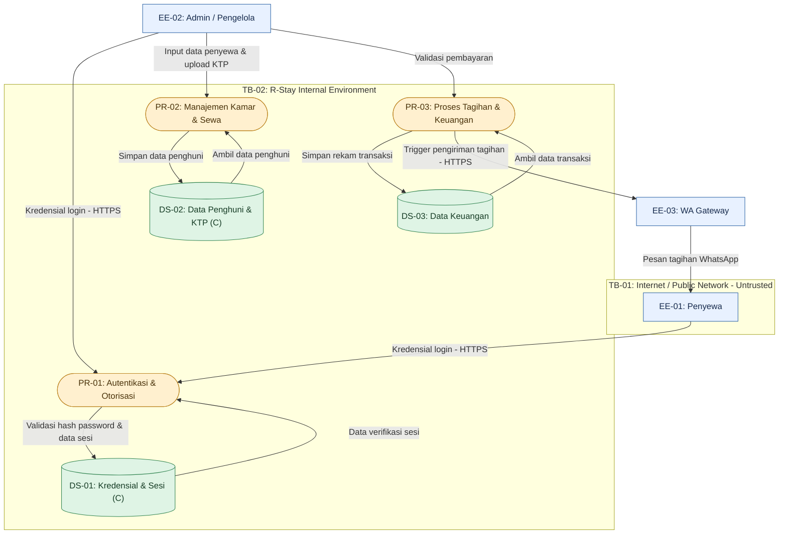

# Diagram Aliran Data (DFD): R-Stay Property & Operations Management System

## 1. Pendahuluan
Dokumen ini memuat Diagram Aliran Data (DFD) Level 0 untuk produk **R-Stay**. Diagram ini memetakan seluruh entitas eksternal, proses inti sistem, tempat penyimpanan data (*data stores*), batas kepercayaan (*trust boundaries*), serta penandaan aset data yang dilindungi menggunakan mekanisme kriptografi.

## 2. Diagram Aliran Data (DFD)

## 3. Penjelasan Komponen Diagram

### A. Entitas Eksternal (External Entities)

1. **EE-01: Penyewa:** Pengguna akhir (penghuni kos) yang berinteraksi melalui jaringan publik untuk melihat informasi kamar dan menerima pengingat tagihan.
2. **EE-02: Admin / Pengelola:** Pengguna berhak akses tinggi yang mengelola data master kamar, mendaftarkan penghuni, memvalidasi pembayaran, dan melihat laporan keuangan.
3. **EE-03: WA Gateway:** Layanan API pihak ketiga eksternal yang bertugas mengirimkan pesan teks pengingat tagihan ke nomor WhatsApp penyewa.

### B. Batas Kepercayaan (Trust Boundaries)

1. **TB-01 (Internet / Public Network — Untrusted):** Zona jaringan publik tempat penyewa mengakses aplikasi. Seluruh komunikasi pada area ini wajib dienkripsi menggunakan protokol **HTTPS/TLS** untuk mencegah intersepsi data.
2. **TB-02 (R-Stay Internal Environment):** Zona internal sistem tempat pemrosesan logika aplikasi dan penyimpanan basis data dikendalikan secara ketat oleh server aplikasi.

### C. Proses Utama (Processes)

1. **PR-01 (Autentikasi & Otorisasi):** Menangani proses masuk (*login*), pencocokan kredensial, dan penerbitan token sesi (*Session Token/JWT*).
2. **PR-02 (Manajemen Kamar & Sewa):** Mengelola data ketersediaan unit kamar, pendaftaran penghuni baru, dan pengunggahan arsip identitas.
3. **PR-03 (Proses Tagihan & Keuangan):** Menghitung besaran tagihan, mencatat status pembayaran lunas/menunggak, serta memicu pengiriman notifikasi tagihan otomatis.

### D. Penyimpanan Data & Penandaan Kriptografi (Data Stores)

Sesuai rubrik penilaian, komponen penyimpanan data yang diamankan dengan enkripsi atau fungsi hash ditandai dengan label **(C)**:

1. **DS-01: Kredensial & Sesi (C):** Menyimpan data kata sandi pengguna yang telah dilindungi menggunakan fungsi *slow hash* (Bcrypt/Argon2) serta token sesi aktif terenkripsi.
2. **DS-02: Data Penghuni & KTP (C):** Menyimpan basis data biodata penghuni serta berkas unggahan foto KTP yang diamankan dengan enkripsi saat disimpan (*Encryption at-Rest*).
3. **DS-03: Data Keuangan:** Menyimpan rekam jejak transaksi pembayaran, status piutang, dan riwayat tagihan bulanan kos.