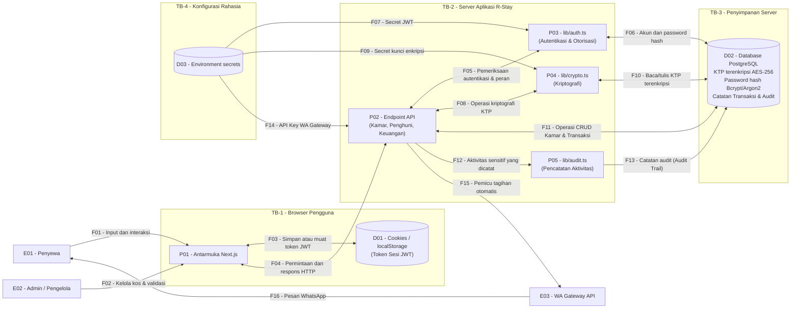

# Diagram Aliran Data (DFD): R-Stay

## 1. Pendahuluan
Dokumen ini memuat Diagram Aliran Data (DFD) Level 0 untuk produk **R-Stay**. Diagram ini dirancang dengan tata letak vertikal (*portrait*) yang terstruktur lurus dan rapi guna memetakan seluruh interaksi pengguna, proses inti sistem, tempat penyimpanan data, batas kepercayaan, serta penandaan aset yang dilindungi menggunakan mekanisme kriptografi.

## 2. Diagram Aliran Data (DFD)

## 3. Penjelasan Alur dan Komponen Diagram

Diagram di atas menguraikan bagaimana data mengalir dari pengguna menuju pusat penyimpanan sistem R-Stay secara sistematis:

### A. Pihak yang Terlibat (Entitas Eksternal)

1. **EE-01 (Penyewa):** Pengguna akhir yang mengakses sistem melalui jaringan publik untuk memantau informasi sewa dan menerima pesan pengingat tagihan.
2. **EE-02 (Admin / Pengelola):** Pengguna dengan hak akses tinggi yang mengelola data master kamar, mendaftarkan penghuni, serta memvalidasi transaksi keuangan kos.
3. **EE-03 (WA Gateway):** Layanan pihak ketiga eksternal yang berfungsi menjembatani pengiriman pesan teks pengingat tagihan ke nomor WhatsApp penghuni.

### B. Batas Keamanan Jaringan (Trust Boundaries)

1. **Batas Kepercayaan 1 (Jaringan Publik / Internet):** Zona luar yang tidak tepercaya. Seluruh komunikasi data yang berasal dari area ini wajib dienkripsi menggunakan protokol **HTTPS** demi mencegah penyadapan informasi.
2. **Batas Kepercayaan 2 (Lingkungan Internal R-Stay):** Zona internal aplikasi tempat pemrosesan logika dan penyimpanan basis data dikendalikan secara ketat oleh server.

### C. Proses Utama Sistem (Processes)

1. **PR-01 (Autentikasi & Otorisasi):** Berfungsi memeriksa kecocokan data masuk (*login*) serta mengelola sesi aktif pengguna.
2. **PR-02 (Manajemen Kamar):** Bertanggung jawab atas pengelolaan ketersediaan unit kamar, pendataan penghuni baru, dan penyimpanan berkas identitas.
3. **PR-03 (Proses Keuangan):** Mengatur perhitungan tagihan bulanan, pencatatan status pembayaran, serta memicu pengiriman notifikasi penagihan.

### D. Tempat Penyimpanan Data & Perlindungan Kriptografi (Data Stores)

Komponen yang diberi tanda **(C)** merupakan penyimpanan data yang diamankan menggunakan mekanisme kriptografi:

1. **DS-01 (Kredensial & Sesi - C):** Menyimpan kata sandi pengguna dalam bentuk *hash* yang aman (menggunakan fungsi *slow hash*) serta mengamankan token sesi aktif.
2. **DS-02 (Data Penghuni & KTP - C):** Menyimpan data biodata serta berkas foto kartu identitas (KTP) penghuni yang dilindungi dengan enkripsi saat disimpan di server (*Encryption at-Rest*).
3. **DS-03 (Data Keuangan):** Menyimpan rekam jejak transaksi pembayaran sewa kos dan status pelunasan secara berkala.
